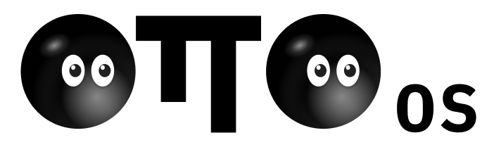
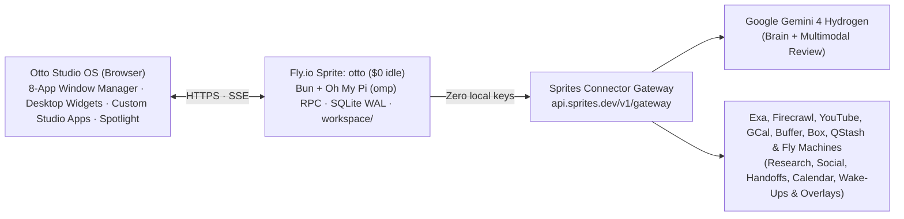

<p align="center">
  
</p>

<h1 align="center">Otto OS — Cloud Studio OS &amp; Livestreamer Manager Agent</h1>

<p align="center">
  <b>Otto OS turns one $0-idle Fly.io Sprite into a Cloud Studio OS for solo livestreamers: an 8-app creator desktop with live YouTube &amp; stream countdown widgets, a second auto-stop Fly Machine hosting live OBS overlays, one shared SQLite studio brain, deterministic VOD hype clipping with 1-click Box handoff to human editors, and 9 zero-key Sprites Connectors — zero API keys or session cookies in the VM, zero AI-generated art or video.</b>
  <br>
  Powered by <a href="https://github.com/can1357/oh-my-pi">Oh My Pi (<code>omp</code>)</a> on <a href="https://sprites.dev">Fly.io Sprites</a> &amp; Sprites Connectors · Built for <a href="https://fly.io/hacksgiving">Fly.io Hacksgiving 2026</a>.
</p>

<p align="center">
  
  
  
  
  
</p>

<p align="center">
  
  <br>
  <sub><b>Otto Studio OS</b>: a multi-window cloud desktop inside one Fly.io Sprite — 8 wired draggable apps (Otto Chat, Studio Files, OBS Overlays, Ideas, Analytics, Calendar, Contacts, System Settings) plus live Desktop Widgets (zero-LLM YouTube Metrics + Next Stream Countdown), unlimited installable Custom Studio Apps on the Desktop, <code>Cmd+K</code> Spotlight launcher, pure-SVG 3D cursor-tracking Otto mascot, 3-step Setup Wizard (413 IANA timezones), 2-way Google Calendar + QStash wake-ups, and Zero-Key Connectors. <i>Live instance is passcode-protected to protect private OAuth/API quotas — demo credentials are provided privately in the Hacksgiving submission form, or deploy your own in 1 prompt below.</i></sub>
</p>

<br>

---

```text
╭─ sprite: otto · google/gemini-4-hydrogen · mnemopi ───────────────────────────╮
│                                                                               │
│  you › Plan tonight's 2-hour gaming stream, lock it on my calendar at 20:00,  │
│        and draft promo posts. Also can you generate an AI thumbnail?          │
│                                                                               │
│ otto › Hard no on AI thumbnails — keep your visuals human-made. Here's a      │
│        tight brief you can hand straight to your artist instead.              │
│                                                                               │
│        Everything else is done:                                               │
│          1. Run-of-show saved to Studio Files (/scripts) & Ideas board        │
│          2. Added to Calendar + synced to Google Calendar (T-1h check-in set) │
│          3. Tailored X, TikTok & IG announcements queued as Buffer Drafts     │
│                                                                               │
╰───────────────────────────────────────────────────────────────────────────────╯
```

<br>

---

## The Solo Streamer Burnout Trap

You boot up OBS, stream for seven hours straight because you have the time, and close the broadcast exhausted. There is no YouTube video waiting to be cut, no clear segment structure, and no one holding you accountable when your packaging slips or your schedule bleeds into burnout.

Meanwhile, most "AI creator tools" try to replace the exact craft your community actually loves — churning out uncanny AI thumbnails, slop overlays, and synthetic clips that alienate viewers and undercut the human artists, riggers, clippers, and editors who keep streaming alive.

**Otto OS turns one $0-idle Fly.io Sprite into a persistent Cloud Studio OS and practical talent manager — automating research, prep, clipping, overlays, and scheduling while keeping 100% of your art and video human-made.**



- **`$0` idle, still proactive.** Signed QStash wake-ups plus a `/.sprite/api.sock` Tasks hold (5-minute heartbeat, hard 30-minute ceiling) fire pre-stream reminders, daily zero-LLM YouTube metric snapshots, and recurring `CRON_TZ` jobs while the Sprite sleeps ([`agent/extensions/qstash-scheduler.ts`](agent/extensions/qstash-scheduler.ts)).
- **Apps Otto writes for you.** `studio_app_create` installs a Custom Studio App as its own native desktop window with Otto's design tokens, running at opaque origin behind a tokenized `window.ottoApp` bridge that survives reloads ([`agent/lib/studio-apps.ts`](agent/lib/studio-apps.ts)).
- **Overlays on their own machine.** One tool call provisions a 256 MB Fly Machine + 1 GB Volume through the Machines API — no Dockerfile, `autostop`, `min_machines_running: 0` — serving transparent 1080p OBS sources with mobile remote decks ([`agent/lib/obs-overlays.ts`](agent/lib/obs-overlays.ts)).
- **One brain, two surfaces.** 5 SQLite WAL tables and a `realpathSync`-jailed workspace are shared by agent tools and the 8-app desktop (including dedicated **Ideas** and **Analytics** apps with direct YouTube Studio deep links), reconciled over one SSE stream the moment a tool finishes.
- **Craft, not slop.** Four chat Z-scores with a 35-second lag pre-roll cut `.mp4` + `.srt` at −14 LUFS with 1-click **Box** handoff for human editors; `generate_image: deny` is enforced in tool policy, not in prose.

<br>

---

## Two Machines, One Studio

The Studio OS runs on the Sprite. The **overlays run on a machine Otto provisions for itself**, because a live OBS Browser Source should not sleep when the agent does.

`obs_overlay_deploy` drives the Fly Machines API directly: `POST /v1/apps`, allocated shared IPv4 + IPv6, a `1 GB` Volume, and a `256 MB` `shared-cpu-1x` machine whose Bun server is injected through `config.files` — **no Dockerfile, no image build** — then sets `autostart: true`, `autostop: "stop"`, `min_machines_running: 0`. The host costs `$0` while idle and still serves transparent `1920×1080` OBS sources (`/o/<slug>`), SSE state (`/o/<slug>/events`), and tokenized mobile Remote Control Decks (`/c/<slug>?token=…`) the moment you go live ([`agent/lib/obs-overlays.ts`](agent/lib/obs-overlays.ts), [`agent/extensions/obs-overlays.ts`](agent/extensions/obs-overlays.ts)).

The Sprite side is a real **Sprites Service**, not a foreground process: `setup.sh` registers `lma-web` on port `8080` with auto-restart and recreates it idempotently on every run ([`setup.sh`](setup.sh)).

<br>

---

## Verifiable Engineering Scorecard

Every capability below is verified directly against source files in this repository:

| Rubric Axis | Exact Code-Backed Proof | Source |
| :--- | :--- | :--- |
| **Fly.io Primitive Depth (5/5)** | **`sprite-env services` runtime** (idempotent `lma-web` on `:8080`, auto-restart) + **9 zero-key Sprites Connectors** (`/v1/gateway/list` runtime discovery, incl. **Apify**, **Box** &amp; **Fly Machines API**) + `/.sprite/api.sock` Tasks API hold (5m heartbeat, 30m cap) + `<1s` QStash wake-up from `$0` sleep + CoW Checkpoint time-travel on `post-commit` + zero-Docker **Fly Machine + 1 GB Fly Volume** auto-stop OBS overlay host | [`agent/extensions/`](agent/extensions), [`agent/lib/obs-overlays.ts`](agent/lib/obs-overlays.ts), [`web/server.ts`](web/server.ts), [`scripts/sync-initialized-checkpoint.sh`](scripts/sync-initialized-checkpoint.sh) |
| **Concrete System Scope** | **14 extensions**, **46 registered tools** (+ `--new`), **8 skills** (7 ops/craft + 1 opt-in `streaming-coaching`), **5 SQLite WAL tables**, **8 wired Desktop OS apps + live Desktop Widgets + dynamic Custom Studio App windows**, **51 authenticated REST/SSE handler branches** — and **144 vendored `shadcn-vue` primitives vs 40 hand-written `web/src` files**, so the line count is not padded scope | [`agent/extensions/`](agent/extensions), [`agent/lib/studio-db.ts`](agent/lib/studio-db.ts), [`web/server.ts`](web/server.ts), [`web/src/components/`](web/src/components) |
| **Security &amp; Isolation** | Live `zeroLocalKeys` + `aiMediaDisabled` telemetry; zero API keys or browser cookie jars in the VM; secrets stripped from `omp` env; ephemeral 24-byte `LMA_INTERNAL_SECRET`; dual-key QStash JWT + SHA-256 body hash; `fly-client-ip` 5/min limiter; `realpathSync` symlink-denying jail + anti-stored-XSS; HTTPS SSRF guard; read-only SQL allowlist (single statement, 100-row cap); opaque-origin Custom Studio App sandbox with a per-render 128-bit capability token; 100 MB upload / 2 MB inline-edit caps | [`web/server.ts`](web/server.ts), [`web/lib/workspace.ts`](web/lib/workspace.ts), [`web/src/lib/studio-app-sandbox.ts`](web/src/lib/studio-app-sandbox.ts), [`agent/extensions/media-reviewer.ts`](agent/extensions/media-reviewer.ts), [`agent/lib/studio-db.ts`](agent/lib/studio-db.ts) |
| **Deterministic Systems Craft** | 12-thread InnerTube parallel chat pull (~30s/4h VOD); 4-signal rolling Z-score + 35s lag pre-roll; dynamic 480p/2fps FFmpeg multimodal proxy; `-14 LUFS` CFR 30fps prep; reschedule delta QStash auto-re-arming + RFC 5545 `.ics` `VALARM`s | [`agent/skills/raw-clip-finder/scripts/`](agent/skills/raw-clip-finder/scripts), [`agent/extensions/media-reviewer.ts`](agent/extensions/media-reviewer.ts), [`agent/extensions/qstash-scheduler.ts`](agent/extensions/qstash-scheduler.ts) |
| **Reproducible Verification** | **24 deterministic fast checks** (~10s, run inside the Sprite against the live `:8080` service) + `--live` (**25 checks**, live zero-key round-trip) + **5 multi-turn E2E playbooks** graded against golden [`expected-memory.md`](scripts/e2e/expected-memory.md) via Sprite Checkpoint restore | [`scripts/verify-all.sh`](scripts/verify-all.sh), [`scripts/e2e/`](scripts/e2e) |

**Recompute every number above** — no trust required: `ls agent/extensions/*.ts | wc -l` → 14 · `grep -h "pi.registerTool" agent/extensions/*.ts | wc -l` → 46 · `ls -d agent/skills/*/ | wc -l` → 8 · `grep -c "CREATE TABLE" agent/lib/studio-db.ts` → 5 · `grep -cE '^    id: "' web/src/composables/useWindowManager.ts` → 8 · `grep -cE 'url\.pathname (===|\.startsWith)' web/server.ts` → 51 · `expr $(grep -c '^check_grep ' scripts/verify-all.sh) + 1` → 24 · `ls scripts/e2e/0*.md | wc -l` → 5 · `git ls-files 'web/src/components/ui/*' | wc -l` → 144.

<br>

---

## Replicate This Setup With Your Coding Agent

Already using Claude Code, `omp`, Pi, or Codex? Hand it this prompt to spin up your own **Otto OS** Sprite in under a minute — no manual config editing required:

```text
Set me up with my own "Otto" personal Cloud Studio OS & Livestreamer Manager agent on Fly.io Sprites:
1. Follow https://fly.io/sprites/agent-ready.md to verify the Sprite CLI and Fly.io auth.
2. Create a Sprite named "otto" and set it active (`sprite create --skip-console otto && sprite use otto`).
3. Inside the Sprite, clone https://github.com/roffidaijoubu/otto.git into ~/lma and run `bash ~/lma/setup.sh` (installs omp, ffmpeg, yt-dlp, symlinks agent config/extensions, and initializes MEMORY.md).
4. Inside the Sprite, check `curl -s https://api.sprites.dev/v1/gateway/list` and follow `docs/setup/README.md` to provision any missing Sprites Connectors (then re-run `bash ~/lma/setup.sh` so `~/.omp/agent/models.yml` is written):
   - Required: Google Gemini (for LLM + multimodal review). Optional built-ins: Exa, Firecrawl, Box.
   - Optional Custom API connectors via `sprite api`: `docs/setup/composio-youtube.md` (YouTube + Google Calendar), `docs/setup/buffer.md` (X/TikTok/IG), `docs/setup/qstash-scheduler.md` (proactive wake-ups), plus Fly Machines for OBS Overlays.
   - Do as much as possible via CLI; only ask me when you need an API key, OAuth click, or if a CLI step fails.
```

> **Zero outbound API keys:** All 8 third-party API keys and OAuth tokens stay inside Fly.io's encrypted organization gateway — never inside the Sprite VM or this repository. `setup.sh` auto-generates your private Web UI passcode in `chmod 600 ~/.config/lma/web.env` and auto-discovers every authorized connector at runtime.

### Manual Setup (4 Commands)

Prefer to run it directly from your terminal?

```bash
# 1. Create and select your persistent Sprite
sprite create --skip-console otto && sprite use otto

# 2. Add the required Google Gemini connector in https://sprites.dev -> Connectors
#    (and grant access to your `otto` Sprite)

# 3. Clone the repo inside the Sprite and run the idempotent installer
sprite exec -- bash -c "git clone https://github.com/roffidaijoubu/otto.git ~/lma && bash ~/lma/setup.sh"
#    (setup.sh prints your auto-generated Web UI passcode stored in ~/.config/lma/web.env)

# 4. Open Otto Studio OS at https://<your-sprite>.sprites.app
#    (or chat directly from your terminal via: sprite console && omp)
```

<br>

---

## How Sprites Connectors Power Otto

**Otto OS** never stores `GEMINI_API_KEY`, `EXA_API_KEY`, or `FIRECRAWL_API_KEY` inside the Sprite. Each external capability connects through the organization-level [Fly.io Sprites Connector Gateway](https://docs.fly.io/sprites/concepts/connectors.md):

| Connector | Role in Otto OS | Discovery Mechanism |
| :--- | :--- | :--- |
| **Google Gemini** | LLM brain (`google/gemini-4-hydrogen:auto`, `google/gemini-3.5-flash-lite` for smol/memory roles) + multimodal review | Auto-written to `~/.omp/agent/models.yml` by `setup.sh` |
| **Exa** | First-class `exa_search` &amp; `exa_get_contents` research tools | Auto-discovered at runtime via [`agent/extensions/exa-gateway.ts`](agent/extensions/exa-gateway.ts) |
| **Firecrawl** | First-class `firecrawl_scrape` clean Markdown scraper | Auto-discovered at runtime via [`agent/extensions/firecrawl-gateway.ts`](agent/extensions/firecrawl-gateway.ts) |
| **YouTube &amp; GCal (Composio v3)** | Channel stats, recent videos, captions, packaging ops &amp; 2-way Google Calendar sync | Auto-discovered Custom API connector ([setup guide](docs/setup/composio-youtube.md)) |
| **Buffer (X / TikTok / IG)** | Per-channel posts — draft, schedule, or publish (`x_post`, `tiktok_post`, `instagram_post`, `saveToDraft: true` default) | Shared helper [`agent/lib/buffer.ts`](agent/lib/buffer.ts) ([setup guide](docs/setup/buffer.md)) |
| **Apify (TikTok / IG / X Read)** | Curated, credit-capped social research (`tiktok_read`, `instagram_read`, `x_read` via allowlisted pay-per-event actors) | Auto-discovered built-in connector via [`agent/lib/apify.ts`](agent/lib/apify.ts) |
| **Upstash QStash** | Agent self-scheduled one-shot, lifecycle &amp; `CRON_TZ` wake-ups (`schedule_wakeup`) | Auto-discovered Custom API connector ([setup guide](docs/setup/qstash-scheduler.md)) |
| **Box** | 1-click file &amp; folder handoff of `-14 LUFS` raw VOD clips &amp; briefs to human editors/artists (`Otto Handoffs/`) + pull artist thumbnail drafts for multimodal review | Auto-discovered built-in OAuth connector ([`agent/extensions/box-gateway.ts`](agent/extensions/box-gateway.ts)) |
| **Fly Machines (`api.machines.dev`)** | Zero-Docker provisioning of a dedicated `256 MB` auto-stop Fly Machine + `1 GB` Volume for public OBS Browser Source Overlays &amp; SSE remote control | Auto-discovered Custom API connector ([`agent/lib/obs-overlays.ts`](agent/lib/obs-overlays.ts)) |

> All **10 gateway-backed extensions** (`tiktok`, `instagram`, `x-twitter`, `composio-youtube`, `box-gateway`, `exa-gateway`, `firecrawl-gateway`, `media-reviewer`, `qstash-scheduler`, `obs-overlays`) query `GET https://api.sprites.dev/v1/gateway/list` inside the Sprite and cache the authorized `gateway_base_url`, so the repository contains zero hardcoded connector IDs. The **4 local-only extensions** (`studio-apps`, `studio-db`, `vod-clipper`, `new-session`) operate strictly inside the Sprite.

<br>

---

## Architecture &amp; Key Files

Rather than turning `~/.omp/` into a messy git repo full of session logs and SQLite caches, **Otto OS** keeps a clean source repository and symlinks only the agent definition into `~/.omp/agent/`:

| Path | Purpose |
| :--- | :--- |
| [`agent/APPEND_SYSTEM.md`](agent/APPEND_SYSTEM.md) | Otto persona, pragmatic ops rules, strict no-AI-media guardrail, voice/character rules, and memory protocol |
| [`agent/config.yml`](agent/config.yml) | Gemini-only model roles (`google/gemini-4-hydrogen:auto` + `gemini-3.5-flash-lite`), Mnemopi SQLite memory (`noEmbeddings: true`), and `generate_image: deny` |
| [`agent/lib/studio-db.ts`](agent/lib/studio-db.ts) | Shared **5-table** SQLite WAL database (`~/.omp/agent/studio.db`) backing Calendar, Ideas (`content_pipeline`), Contacts, Analytics (`channel_metrics`) &amp; Studio Meta |
| [`agent/extensions/`](agent/extensions) | **14 extensions** exposing **46 registered `omp` tools** (per-channel `tiktok`, `instagram`, `x-twitter` combining Apify Read + Buffer Drafts, plus YouTube, Box, Exa, Firecrawl, QStash, Fly Machines `obs-overlays`, local `studio-apps`, VOD clipper, media review, `studio-db`) + `--new` CLI flag |
| [`agent/skills/`](agent/skills) | **8 streamer skills**: 7 core ops &amp; craft skills (`onboarding`, `youtube-audit`, `stream-planner`, `social-promo`, `raw-clip-finder`, `studio-app-craft`, `obs-overlay-craft`) + 1 opt-in `streaming-coaching` skill |
| [`web/`](web) | Bun RPC supervisor (`server.ts`, `workspace.ts`) + Vue 3 / Vite / `shadcn-vue` / Reka UI / Tailwind CSS v4 **Otto Studio OS** (8 wired desktop apps — incl. **Ideas**, **Analytics** w/ YouTube Studio links, **Studio Files** w/ 1-click Box handoff &amp; **System Settings** w/ inline `MEMORY.md` profile editing — plus live Desktop Widgets, dynamic Custom Studio App windows, Fly Machine `OBS Overlays`, `SpotlightCommand`, `OttoMascot` &amp; `StudioSetupWizard`) |
| [`scripts/`](scripts) | Auto-checkpoint sync (`sync-initialized-checkpoint.sh`), headless OAuth dossier bootstrap (`bootstrap-dossier.sh`), **24-check** `verify-all.sh` (**25** with `--live`), &amp; 5 multi-turn E2E playbooks (`scripts/e2e/`) |
| [`setup.sh`](setup.sh) | Idempotent bootstrap: installs `omp`, `ffmpeg`, `yt-dlp`, scaffolds `/home/sprite/workspace/`, builds `web/`, registers `lma-web`, and auto-bootstraps Draft Studio Profile |

### Why Fly.io Sprites Made Building Otto 10× Faster

Beyond zero-key **Sprites Connectors** and $0-idle auto-sleep (paired with **Upstash QStash + `/.sprite/api.sock` Tasks API** for proactive wake-ups), **Sprites' copy-on-write Checkpoints** solved stateful agent testing:

- Every `git commit` auto-refreshes an `initialized: <sha>` checkpoint — seeded from your gitignored live dossier by default (`--no-memory` / `LMA_NO_MEMORY=1` for a blank `MEMORY.md`), with Mnemopi/`studio.db`/`studio-apps`/`workspace/` reset and `web/` rebuilt ([`scripts/sync-initialized-checkpoint.sh`](scripts/sync-initialized-checkpoint.sh)).
- Any fresh coding agent can read [`scripts/e2e/INDEX.md`](scripts/e2e/INDEX.md), `sprite restore` back to `initialized:` in ~1 second, run all 5 multi-turn behavioral playbooks grading Otto's live tool calls and memory against [`expected-memory.md`](scripts/e2e/expected-memory.md), and jump right back to live prod state with zero data loss.

> **For judges &amp; engineers:** Read the full [Architecture Deep Dive (`docs/architecture.md`)](docs/architecture.md) for the `omp` RPC supervisor design, Otto Studio OS window architecture, 12-thread InnerTube chat-pull math, and defense-in-depth security model.

<br>

---

## Project Status

Built actively during **Fly.io Hacksgiving 2026**:

- ✅ **Otto Studio OS Multi-Window Cloud Desktop, Desktop Widgets, Custom Studio Apps &amp; Fly Machine OBS Overlays** (Vue 3 + Vite + `shadcn-vue` + Reka UI + Tailwind CSS v4, **8 wired draggable apps** — Otto Chat, Studio Files w/ 1-click Box handoff, OBS Overlays, Ideas, Analytics w/ YouTube Studio deep links, Calendar, Contacts, System Settings w/ inline `MEMORY.md` Creator &amp; Timezone editing — plus live right-side Desktop Widgets for zero-LLM YouTube Metrics &amp; Next Stream Countdown, unlimited Desktop Custom Studio Apps with independent OS windows &amp; persistent `window.ottoApp` state, Fly Machine `256 MB`/1 GB Volume live OBS Overlays with SSE remote control decks, edge snapping, layout presets, `Cmd+K` Spotlight, pure-SVG 3D cursor-tracking Otto mascot, and 3-step Setup Wizard w/ 413 IANA timezones)
- ✅ **Proactive QStash Ops &amp; 2-Way Google Calendar** (`CRON_TZ` timezone-aware schedules, daily zero-LLM YouTube metrics sync, QStash + `/.sprite/api.sock` Tasks API keep-alive hold, reschedule delta auto-re-arming + 2-way Google Calendar + RFC 5545 `.ics` `VALARM`s)
- ✅ **Unified 2-Way Workspace + 5-Table SQLite WAL Studio Brain + Creator Rolodex CRM** (`/home/sprite/workspace/` `realpathSync` jail w/ Range/206, 500 MB ZIP export &amp; 1-click Box handoff; `~/.omp/agent/studio.db` w/ 10 agent tools &amp; live SSE sync; 3-pane human-team Contacts CRM)
- ✅ **Zero-Key Sprites Connectors, Hard No-AI-Art Enforcement &amp; Deterministic VOD Clipper** (**8 zero-key connectors**, `generate_image: deny`, 12-thread InnerTube chat pull + 35s lag pre-roll + `-14 LUFS` CFR 30fps output, 480p/2fps FFmpeg multimodal proxy + SSRF guard, **24/24** deterministic checks)
- ⚠️ Final Hacksgiving demo video &amp; submission — ready to record.

<br>

---

## Built By &amp; Acknowledgements

- **Built by [Roffi Daijoubu](https://www.youtube.com/@roffi_daijoubu)** ([@Roffi_Daijoubu](https://x.com/Roffi_Daijoubu)) — an indie VTuber from Indonesia who built **Otto OS** to solve a real solo-creator bottleneck: keeping stream prep structured, titles sharp, social promos consistent, and raw VOD clips ready for human clippers and editors — without burning out or ever touching AI-generated art or video.
- **Powered by [Oh My Pi (`omp`)](https://github.com/can1357/oh-my-pi):** Otto runs on `omp` as its persistent agent runtime (RPC supervisor, extensions, skills, and Mnemopi SQLite memory) — and the stylized `tt` in the Otto logo is a direct nod to the Oh My Pi mark.
- **Optional Coaching Skill Acknowledgement:** The opt-in `streaming-coaching` skill (activated only if a creator explicitly asks for streaming strategy or growth advice) is inspired by **[Ludwig Ahgren](https://www.youtube.com/@ludwig)**'s *Professor L* curriculum at **Streamer University** — specifically his [*"How to Get Lucky"* lecture](https://youtu.be/sXRtZaK1Nlw). *(Independent fan-built project; not affiliated with or endorsed by Ludwig Ahgren or Mogul Moves.)*

<br>

---

<p align="center">
  <a href="docs/architecture.md">Architecture Deep Dive</a> · <a href="docs/setup/README.md">Agent Setup Guides</a> · <a href="DESIGN.md">Design System</a> · <a href="AGENTS.md">Agentic Workflow</a> · <a href="https://fly.io/hacksgiving">Fly.io Hacksgiving</a>
</p>

<p align="center">
  <sub>MIT License</sub>
</p>
