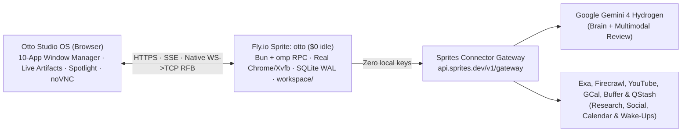

<p align="center">
  
</p>

<h1 align="center">Otto OS — Cloud Studio OS &amp; Livestreamer Manager Agent</h1>

<p align="center">
  <b>Otto OS turns one $0-idle Fly.io Sprite into a persistent Cloud Studio OS and AI Talent Manager — a 10-app multi-window desktop with live sandboxed Artifacts (HTML/React/SVG/Mermaid), embedded real Chrome (noVNC) with HITL 2FA cookie auth + OpenCLI, 6 zero-key Sprites Connectors, proactive QStash wake-ups, nightly self-learning playbooks, deterministic VOD hype clipping, and strictly zero AI-generated art or video.</b>
  <br>
  Built for <a href="https://fly.io/hacksgiving">Fly.io Hacksgiving 2026</a> on <a href="https://sprites.dev">Sprites</a>, <a href="https://github.com/can1357/oh-my-pi">omp</a>, and Sprites Connectors.
</p>

<p align="center">
  
  
  
  
  
</p>

<p align="center">
  
  <br>
  <sub><b>Otto Studio OS</b>: a multi-window cloud desktop inside one Fly.io Sprite — 10 wired draggable apps (Otto Chat, Mission Control, Studio Files, Live Artifacts, Embedded Chrome, Studio DB, Playbooks, Calendar, Contacts, System Settings), <code>Cmd+K</code> Spotlight URL-to-Chrome routing, pure-SVG 3D cursor-tracking Otto mascot, 3-step Setup Wizard (400+ IANA timezones), 2-way Google Calendar + QStash wake-ups, and Zero-Key Connectors. <i>Live instance is passcode-protected to protect private OAuth/API quotas — demo credentials are provided privately in the Hacksgiving submission form, or deploy your own in 1 prompt below.</i></sub>
</p>

<br>

---

```text
╭─ sprite: otto · google/gemini-4-hydrogen · mnemopi ───────────────────────────╮
│                                                                               │
│  you › Plan tonight's 2-hour gaming stream, lock it on my calendar at 20:00,  │
│        and draft promo posts. Also can you generate an AI thumbnail?          │
│                                                                               │
│ otto › Hard no on AI thumbnails — keep your visuals human-made. Here's a      │
│        tight brief you can hand straight to your artist instead.              │
│                                                                               │
│        Everything else is done:                                               │
│          1. Run-of-show saved to Studio Files (/scripts) & Content Pipeline   │
│          2. Added to Calendar + synced to Google Calendar (T-1h check-in set) │
│          3. Tailored X, TikTok & IG announcements queued as Buffer Drafts     │
│                                                                               │
╰───────────────────────────────────────────────────────────────────────────────╯
```

<br>

---

## The Solo Streamer Burnout Trap

You boot up OBS, stream for seven hours straight because you have the time, and close the broadcast exhausted. There is no YouTube video waiting to be cut, no clear segment structure, and no one holding you accountable when your packaging slips or your schedule bleeds into burnout.

Meanwhile, most "AI creator tools" try to replace the exact craft your community actually loves — churning out uncanny AI thumbnails, slop overlays, and synthetic clips that alienate viewers and undercut the human artists, riggers, clippers, and editors who keep streaming alive.

**Otto OS turns one $0-idle Fly.io Sprite into a persistent Cloud Studio OS and practical talent manager — automating research, browser ops, prep, clipping, and scheduling while keeping 100% of your art and video human-made.**



- **Embedded Real Chrome (noVNC) + Exit-77 HITL Cookie Auth + OpenCLI (100+ Sites):** A zero-dependency native Bun WebSocket-to-TCP RFB proxy (`/api/browser/ws` → `127.0.0.1:5900` `x11vnc`) streams real Google Chrome (no `--enable-automation` flag, persistent `~/.config/lma/chrome-profile`, 2-minute idle auto-shutdown) directly inside Otto Studio OS. Otto runs `@jackwener/opencli` (`opencli_list`, `opencli_run`) over CDP `:9222`; when a site hits login, 2FA, or CAPTCHA (exit code `77`), `browser_login` wakes live Chrome in your browser via an ephemeral 24-byte `LMA_INTERNAL_SECRET`, polls `Network.getAllCookies` every 1200ms until login succeeds, and auto-exports 3 formats (`.json`, Netscape `.cookies.txt` for `yt-dlp`, Playwright `.state.json`).
- **Full Multi-Window Cloud Desktop OS (`Otto Studio OS`) + Live Sandboxed Artifacts:** Built on Vue 3 + Vite + `shadcn-vue` + Reka UI + Tailwind CSS v4, featuring **10 wired draggable apps** (`Otto Chat`, `Mission Control`, `Studio Files`, `Artifacts`, `Embedded Chrome`, `Studio DB`, `Playbooks`, `Calendar`, `Contacts`, `System Settings`), edge-snap ghosts (`left`/`right`/`maximize`), layout presets (`tile-2up`, `focus-chat`, `cascade`, `show-desktop`), floating dock (`Alt+1..9`), `Cmd+K` Spotlight that routes URLs straight into Embedded Chrome, a pure-SVG 3D cursor-tracking Otto mascot, and responsive `<1024px` single-app mode. Otto's `artifact_create` / `artifact_present` tools write persistent files to `/home/sprite/workspace/artifacts/` and live-open them inside an opaque-origin `<iframe sandbox="allow-scripts">` (**HTML/CSS/JS**, **React/JSX/TSX** via Babel + `esm.sh`, **SVG**, **Mermaid**, and **Markdown**) with clickable chat cards and lazy-loaded live thumbnails in Studio Files Grid View.
- **Proactive Ops on a $0-Idle Sleeping VM + Hermes Nightly Self-Learning:** Upstash QStash lifecycle hooks (`promo_24h`, `pre_stream_1h`, `post_stream_vod_3h`) wake the sleeping Sprite in `<1s` and hold Fly.io's `/.sprite/api.sock` Tasks API alive (5-minute heartbeat, 30-minute cap). Rescheduling an event computes the time delta, revokes and re-arms shifted QStash hooks, updates Google Calendar 2-way, and exports RFC 5545 `.ics` feeds with `TRIGGER:-PT15M` `VALARM`s. A timezone-aware `CRON_TZ` midnight reflection pass (`omp --no-session`, secrets stripped) drafts channel-specific SOPs as `pending` (16 KiB / 30-skill cap + prompt-injection denylist) for 1-click Approve/Reject in **Playbooks**.
- **Zero-LLM VOD Hype Clipper + Multimodal Media Reviewer:** Extracts YouTube InnerTube's `playerSeekContinuationData` random-access token and fans out **12 parallel threads** across 10-minute chunks — pulling a 4-hour VOD's live chat in ~30 seconds with zero API keys. Scores 4 rolling Z-score signals (velocity `0.40`, unique-author burst `0.30`, reaction ratio `0.15`, emote burst `0.15`) with a **35-second chat-lag pre-roll** (+15s post-roll) to cut exact `.mp4` + `.srt` normalized to CFR 30fps H.264 `+faststart` at broadcast **-14 LUFS**. Clips >14 MB auto-transcode via an in-memory **480p/2fps FFmpeg proxy** for inline Gemini multimodal review, while `critique_thumbnail` enforces strict HTTPS-only SSRF guards (blocking private/loopback CIDRs and manual 4-hop redirects).
- **One Shared Brain, Creator Rolodex CRM & Hard No-AI-Art Guardrails:** Human and agent share an **8-table SQLite WAL database** (`~/.omp/agent/studio.db`, 14 agent tools, live SSE refresh), a `realpathSync`-jailed 2-way `/home/sprite/workspace/` (HTTP 206 streaming, 500 MB ZIP export, anti-stored-XSS headers), and a 3-pane **Contacts** CRM for human artists, riggers, clippers, editors, and sponsors. Strictly zero AI art or video is enforced at both persona and tool layers (`generate_image: deny`), backed by live computed guardrail telemetry (`zeroLocalKeys: true`, `aiMediaDisabled: true`).

<br>

---

## Verifiable Engineering Scorecard

Every capability below is verified directly against source files in this repository:

| Rubric Axis | Exact Code-Backed Proof | Source |
| :--- | :--- | :--- |
| **Fly.io Primitive Depth (4/4)** | 6 zero-key Sprites Connectors (`/v1/gateway/list` runtime discovery) + `/.sprite/api.sock` Tasks API hold (5m heartbeat, 30m cap) + `<1s` QStash wake-up from `$0` sleep + CoW Checkpoint time-travel on `post-commit` | [`agent/extensions/`](agent/extensions), [`web/server.ts`](web/server.ts), [`scripts/sync-initialized-checkpoint.sh`](scripts/sync-initialized-checkpoint.sh) |
| **Concrete System Scope** | **12 extensions**, **45 registered tools** (+ `--new`), **6 skills** (5 ops + 1 opt-in `streaming-coaching`), **8 SQLite WAL tables**, **10 wired Desktop OS apps**, **46+ authenticated REST/SSE/WS endpoints** | [`agent/extensions/`](agent/extensions), [`agent/lib/studio-db.ts`](agent/lib/studio-db.ts), [`web/server.ts`](web/server.ts), [`web/src/components/`](web/src/components) |
| **Security &amp; Isolation** | Live `zeroLocalKeys` + `aiMediaDisabled` telemetry; secrets stripped from `omp` env; ephemeral 24-byte `LMA_INTERNAL_SECRET`; dual-key QStash JWT + SHA-256 body hash; `fly-client-ip` 5/min limiter; `realpathSync` symlink-denying jail + anti-stored-XSS; HTTPS SSRF guard; AST-checked read-only SQL; prompt-injection denylist + human `pending` gate | [`web/server.ts`](web/server.ts), [`web/lib/workspace.ts`](web/lib/workspace.ts), [`agent/extensions/media-reviewer.ts`](agent/extensions/media-reviewer.ts), [`agent/lib/studio-db.ts`](agent/lib/studio-db.ts), [`agent/lib/learned-skills.ts`](agent/lib/learned-skills.ts) |
| **Deterministic Systems Craft** | Native Bun WS→TCP RFB noVNC proxy; Exit-77 OpenCLI/CDP HITL cookie handoff (3 formats); 12-thread InnerTube parallel chat pull (~30s/4h VOD); 4-signal rolling Z-score + 35s lag pre-roll; dynamic 480p/2fps FFmpeg multimodal proxy; `-14 LUFS` CFR 30fps prep; reschedule delta QStash auto-re-arming + RFC 5545 `.ics` `VALARM`s | [`web/server.ts`](web/server.ts), [`web/lib/browser-manager.ts`](web/lib/browser-manager.ts), [`agent/skills/raw-clip-finder/scripts/`](agent/skills/raw-clip-finder/scripts), [`agent/extensions/media-reviewer.ts`](agent/extensions/media-reviewer.ts), [`agent/extensions/qstash-scheduler.ts`](agent/extensions/qstash-scheduler.ts) |
| **Reproducible Verification** | **27 deterministic fast checks** (~10s) + `--live` (**28 checks**, live zero-key round-trip) + **5 multi-turn E2E playbooks** graded against golden [`expected-memory.md`](scripts/e2e/expected-memory.md) via Sprite Checkpoint restore | [`scripts/verify-all.sh`](scripts/verify-all.sh), [`scripts/e2e/`](scripts/e2e) |

<br>

---

## Replicate This Setup With Your Coding Agent

Already using Claude Code, `omp`, Pi, or Codex? Hand it this prompt to spin up your own **Otto OS** Sprite in under a minute — no manual config editing required:

```text
Set me up with my own "Otto" personal Cloud Studio OS & Livestreamer Manager agent on Fly.io Sprites:
1. Follow https://fly.io/sprites/agent-ready.md to verify the Sprite CLI and Fly.io auth.
2. Create a Sprite named "otto" and set it active (`sprite create --skip-console otto && sprite use otto`).
3. Inside the Sprite, clone https://github.com/roffidaijoubu/otto.git into ~/lma and run `bash ~/lma/setup.sh` (installs omp, ffmpeg, yt-dlp, Chrome/noVNC, OpenCLI, symlinks agent config/extensions, and initializes MEMORY.md).
4. Inside the Sprite, check `curl -s https://api.sprites.dev/v1/gateway/list` and follow `docs/setup/README.md` to provision any missing Sprites Connectors (then re-run `bash ~/lma/setup.sh` so `~/.omp/agent/models.yml` is written):
   - Required: Google Gemini (for LLM + multimodal review). Optional built-ins: Exa, Firecrawl.
   - Optional Custom API connectors via `sprite api`: `docs/setup/composio-youtube.md` (YouTube + Google Calendar), `docs/setup/buffer.md` (X/TikTok/IG), `docs/setup/qstash-scheduler.md` (proactive wake-ups).
   - Do as much as possible via CLI; only ask me when you need an API key, OAuth click, or if a CLI step fails.
```

> **Zero outbound API keys:** All 6 third-party API keys stay inside Fly.io's encrypted organization gateway — never inside the Sprite VM or this repository. `setup.sh` auto-generates your private Web UI passcode in `chmod 600 ~/.config/lma/web.env` and auto-discovers every authorized connector at runtime.

### Manual Setup (4 Commands)

Prefer to run it directly from your terminal?

```bash
# 1. Create and select your persistent Sprite
sprite create --skip-console otto && sprite use otto

# 2. Add the required Google Gemini connector in https://sprites.dev -> Connectors
#    (and grant access to your `otto` Sprite)

# 3. Clone the repo inside the Sprite and run the idempotent installer
sprite exec -- bash -c "git clone https://github.com/roffidaijoubu/otto.git ~/lma && bash ~/lma/setup.sh"
#    (setup.sh prints your auto-generated Web UI passcode stored in ~/.config/lma/web.env)

# 4. Open Otto Studio OS at https://<your-sprite>.sprites.app
#    (or chat directly from your terminal via: sprite console && omp)
```

<br>

---

## How Sprites Connectors Power Otto

**Otto OS** never stores `GEMINI_API_KEY`, `EXA_API_KEY`, or `FIRECRAWL_API_KEY` inside the Sprite. Each external capability connects through the organization-level [Fly.io Sprites Connector Gateway](https://docs.fly.io/sprites/concepts/connectors.md):

| Connector | Role in Otto OS | Discovery Mechanism |
| :--- | :--- | :--- |
| **Google Gemini** | LLM brain (`google/gemini-4-hydrogen:auto`, `google/gemini-3.5-flash-lite` for smol/memory roles) + multimodal review | Auto-written to `~/.omp/agent/models.yml` by `setup.sh` |
| **Exa** | First-class `exa_search` &amp; `exa_get_contents` research tools | Auto-discovered at runtime via [`agent/extensions/exa-gateway.ts`](agent/extensions/exa-gateway.ts) |
| **Firecrawl** | First-class `firecrawl_scrape` clean Markdown scraper | Auto-discovered at runtime via [`agent/extensions/firecrawl-gateway.ts`](agent/extensions/firecrawl-gateway.ts) |
| **YouTube &amp; GCal (Composio v3)** | Channel stats, recent videos, captions, packaging ops &amp; 2-way Google Calendar sync | Auto-discovered Custom API connector ([setup guide](docs/setup/composio-youtube.md)) |
| **Buffer (X / TikTok / IG)** | Draft &amp; schedule posts across X, TikTok, and Instagram (`saveToDraft: true` default) | Auto-discovered Custom API connector ([setup guide](docs/setup/buffer.md)) |
| **Upstash QStash** | Agent self-scheduled one-shot, lifecycle &amp; `CRON_TZ` wake-ups (`schedule_wakeup`) | Auto-discovered Custom API connector ([setup guide](docs/setup/qstash-scheduler.md)) |

> All **6 gateway connector extensions** (`buffer-gateway`, `composio-youtube`, `exa-gateway`, `firecrawl-gateway`, `media-reviewer`, `qstash-scheduler`) query `GET https://api.sprites.dev/v1/gateway/list` inside the Sprite and cache the authorized `gateway_base_url`, so the repository contains zero hardcoded connector IDs. The **6 local-only extensions** (`artifacts`, `browser-auth`, `studio-db`, `vod-clipper`, `skill-learner`, `new-session`) operate strictly inside the Sprite.

<br>

---

## Architecture &amp; Key Files

Rather than turning `~/.omp/` into a messy git repo full of session logs and SQLite caches, **Otto OS** keeps a clean source repository and symlinks only the agent definition into `~/.omp/agent/`:

| Path | Purpose |
| :--- | :--- |
| [`agent/APPEND_SYSTEM.md`](agent/APPEND_SYSTEM.md) | Otto persona, pragmatic ops rules, strict no-AI-media guardrail, voice/character rules, and memory protocol |
| [`agent/config.yml`](agent/config.yml) | Gemini-only model roles (`google/gemini-4-hydrogen:auto` + `gemini-3.5-flash-lite`), Mnemopi SQLite memory (`noEmbeddings: true`), and `generate_image: deny` |
| [`agent/lib/studio-db.ts`](agent/lib/studio-db.ts) | Shared **8-table** SQLite WAL database (`~/.omp/agent/studio.db`) for Calendar, Content Pipeline, Contacts, Metrics, Custom Trackers, Meta &amp; Learned Playbooks |
| [`agent/extensions/`](agent/extensions) | **12 extensions** exposing **45 registered `omp` tools** (Exa, Firecrawl, Composio YouTube/GCal, Buffer, QStash, VOD clipper, media review, `artifacts`, `browser-auth`/OpenCLI, `studio-db`, learned playbooks) + `--new` CLI flag |
| [`agent/skills/`](agent/skills) | **6 streamer skills**: 5 core ops skills (`onboarding`, `youtube-audit`, `stream-planner`, `social-promo`, `raw-clip-finder`) + 1 opt-in `streaming-coaching` skill |
| [`web/`](web) | Bun RPC supervisor (`server.ts`, native WS→TCP RFB proxy, `browser-manager.ts`, `workspace.ts`) + Vue 3 / Vite / `shadcn-vue` / Reka UI / Tailwind CSS v4 **Otto Studio OS** (10 wired desktop apps incl. live sandboxed `Artifacts` + `SpotlightCommand` + `OttoMascot` + `StudioSetupWizard`) |
| [`scripts/`](scripts) | Auto-checkpoint sync (`sync-initialized-checkpoint.sh`), headless OAuth dossier bootstrap (`bootstrap-dossier.sh`), **27-check** `verify-all.sh` (**28** with `--live`), &amp; 5 multi-turn E2E playbooks (`scripts/e2e/`) |
| [`setup.sh`](setup.sh) | Idempotent bootstrap: installs `omp`, `ffmpeg`, `yt-dlp`, real Chrome + `Xvfb`/`x11vnc`, `@jackwener/opencli`, scaffolds `/home/sprite/workspace/`, builds `web/`, registers `lma-web`, and auto-bootstraps Draft Studio Profile |

### Why Fly.io Sprites Made Building Otto 10× Faster

Beyond zero-key **Sprites Connectors** and $0-idle auto-sleep (paired with **Upstash QStash + `/.sprite/api.sock` Tasks API** for proactive wake-ups), **Sprites' copy-on-write Checkpoints** solved stateful agent testing:

- Every `git commit` auto-refreshes a spotless `initialized: <sha>` checkpoint (blank `MEMORY.md`, cleared Mnemopi/`studio.db`/`learned-skills`/`workspace/`, rebuilt `web/`).
- Any fresh coding agent can read [`scripts/e2e/INDEX.md`](scripts/e2e/INDEX.md), `sprite restore` back to `initialized:` in ~1 second, run all 5 multi-turn behavioral playbooks grading Otto's live tool calls and memory against [`expected-memory.md`](scripts/e2e/expected-memory.md), and jump right back to live prod state with zero data loss.

> **For judges &amp; engineers:** Read the full [Architecture Deep Dive (`docs/architecture.md`)](docs/architecture.md) for the `omp` RPC supervisor design, native Bun RFB proxy + Exit-77 HITL Chrome auth sequence, Otto Studio OS window architecture, 12-thread InnerTube chat-pull math, and defense-in-depth security model.

<br>

---

## Project Status

Built actively during **Fly.io Hacksgiving 2026**:

- ✅ **Otto Studio OS Multi-Window Cloud Desktop &amp; Live Artifacts** (Vue 3 + Vite + `shadcn-vue` + Reka UI + Tailwind CSS v4, 10 wired draggable apps incl. opaque-origin sandboxed `Artifacts` for HTML/React/SVG/Mermaid + live Grid thumbnails &amp; clickable chat cards, edge snapping, layout presets, `Cmd+K` Spotlight URL-to-Chrome routing, pure-SVG 3D cursor-tracking Otto mascot, 3-step Setup Wizard w/ 400+ IANA timezones, headless OAuth dossier bootstrap)
- ✅ **Embedded Real Chrome (noVNC) + Exit-77 HITL Cookie Auth + OpenCLI** (native Bun WS→TCP RFB proxy, real Chrome w/ 2-min idle shutdown, ephemeral `LMA_INTERNAL_SECRET`, CDP cookie polling, 3-format export, 100+ OpenCLI sites)
- ✅ **Hermes Nightly Self-Learning &amp; Proactive QStash Ops** (`CRON_TZ` midnight isolated `omp --no-session` reflection → `pending` Playbooks gate; QStash + `/.sprite/api.sock` Tasks API keep-alive hold; reschedule delta auto-re-arming + 2-way Google Calendar + RFC 5545 `.ics` `VALARM`s)
- ✅ **Unified 2-Way Workspace + 8-Table SQLite WAL Studio DB + Creator Rolodex CRM** (`/home/sprite/workspace/` `realpathSync` jail w/ Range/206 &amp; 500 MB ZIP export; `~/.omp/agent/studio.db` w/ 14 agent tools &amp; live SSE sync; 3-pane human-team Contacts CRM)
- ✅ **Zero-Key Sprites Connectors, Hard No-AI-Art Enforcement &amp; Deterministic VOD Clipper** (6 zero-key connectors, `generate_image: deny`, 12-thread InnerTube chat pull + 35s lag pre-roll + `-14 LUFS` CFR 30fps output, 480p/2fps FFmpeg multimodal proxy + SSRF guard, **27/27** deterministic checks)
- ⚠️ Final Hacksgiving demo video &amp; submission — ready to record.

<br>

---

## Built By &amp; Acknowledgements

- **Built by [Roffi Daijoubu](https://www.youtube.com/@roffi_daijoubu)** ([@Roffi_Daijoubu](https://x.com/Roffi_Daijoubu)) — an indie VTuber from Indonesia who built **Otto OS** to solve a real solo-creator bottleneck: keeping stream prep structured, titles sharp, social promos consistent, and raw VOD clips ready for human clippers and editors — without burning out or ever touching AI-generated art or video.
- **Optional Coaching Skill Acknowledgement:** The opt-in `streaming-coaching` skill (activated only if a creator explicitly asks for streaming strategy or growth advice) is inspired by **[Ludwig Ahgren](https://www.youtube.com/@ludwig)**'s *Professor L* curriculum at **Streamer University** — specifically his [*"How to Get Lucky"* lecture](https://youtu.be/sXRtZaK1Nlw). *(Independent fan-built project; not affiliated with or endorsed by Ludwig Ahgren or Mogul Moves.)*

<br>

---

<p align="center">
  <a href="docs/architecture.md">Architecture Deep Dive</a> · <a href="docs/setup/README.md">Agent Setup Guides</a> · <a href="DESIGN.md">Design System</a> · <a href="AGENTS.md">Agentic Workflow</a> · <a href="https://fly.io/hacksgiving">Fly.io Hacksgiving</a>
</p>

<p align="center">
  <sub>MIT License</sub>
</p>
