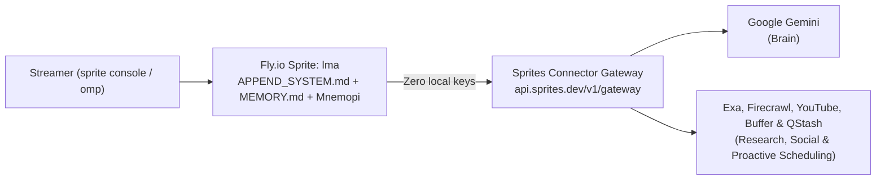

<h1 align="center">lma</h1>

<p align="center">
  <b>Professor L, a persistent personal Talent Manager &amp; Ops Agent for indie livestreamers &amp; VTubers on Fly.io Sprites — zero stored API keys, strictly zero AI-generated art or video.</b>
  <br>
  Built for <a href="https://fly.io/hacksgiving">Fly.io Hacksgiving 2026</a> on <a href="https://sprites.dev">Sprites</a>, <a href="https://github.com/can1357/oh-my-pi">omp</a>, and Sprites Connectors.
</p>

<p align="center">
  
  
  
  
</p>

<br>

---

```text
╭─ sprite: lma · google/gemini-4-neon:auto · mnemopi ───────────────────────────╮
│                                                                               │
│  you › I want to use AI thumbnails to save money, and my goal this year is    │
│        just to "be more confident". Thoughts?                                 │
│                                                                               │
│  lma › Hard no on AI thumbnails. You'll save $30 and get zero clicks — your   │
│        audience smells it immediately. Spend that energy briefing a human     │
│        artist with a thumbnail that passes the Squint Test.                   │
│                                                                               │
│        Also, "be more confident" isn't a goal. Before we plan a single        │
│        stream, finish Homework #1 in MEMORY.md:                               │
│          1. Three concrete, measurable goals for the year                     │
│          2. Your ideal 4–6 hr schedule (with mandatory days off)              │
│          3. Three GOATs — and specifically WHY each one works                 │
│                                                                               │
╰───────────────────────────────────────────────────────────────────────────────╯
```

<br>

---

## The Solo Streamer Burnout Trap

You boot up OBS, stream for seven hours straight because you have the time, and close the broadcast exhausted. There is no YouTube video waiting to be cut, no clear segment structure, and no one holding you accountable when your packaging slips or your schedule bleeds into burnout.

Meanwhile, most "AI creator tools" try to replace the exact craft your community actually loves — churning out uncanny AI thumbnails, slop overlays, and synthetic clips that alienate viewers and undercut the human artists, riggers, clippers, and editors who keep streaming alive.

**`lma` puts a tough-love talent manager inside a persistent Fly.io Sprite — automating research, prep, and long-term accountability while keeping 100% of your art and video human-made.**



- **Strictly no AI-generated images or video:** Enforced both in the agent's persona and at the tool-permission layer (`generate_image: deny`). `lma` helps you prep sharper briefs and cleaner raw material for human artists and clippers — never replaces them.
- **Zero API keys inside the VM:** Every call to Google Gemini, Exa, and Firecrawl routes through [Fly.io Sprites Connectors](https://docs.fly.io/sprites/concepts/connectors.md). Even if you inspect the Sprite's disk or environment, no credentials exist to leak.
- **Sleeps when idle, wakes up remembering everything:** Powered by a persistent NVMe filesystem on Fly.io Sprites, combining a structured `MEMORY.md` talent dossier (3 Goals, Ideal Schedule, 3 GOATs, 3+1 tracker) with built-in **Mnemopi** SQLite memory across sessions.
- **Professor L coaching playbook:** Grounded in Ludwig's *Streamer University* lectures — healthy delusion paired with data honesty, segment-first content funnels, the 3+1 experiment rule, zero-friction collabs, and protecting the talent's humanity.

<br>

---

## Replicate This Setup With Your Coding Agent

Already using Claude Code, `omp`, Pi, or Codex? Hand it this prompt to spin up your own `lma` Sprite in under a minute — no manual config editing required:

```text
Set me up with my own "lma" personal Livestreamer Manager agent on Fly.io Sprites:
1. Follow https://fly.io/sprites/agent-ready.md to verify the Sprite CLI and Fly.io auth.
2. Create a Sprite named "lma" and set it active (`sprite create --skip-console lma && sprite use lma`).
3. Inside the Sprite, clone this repo into ~/lma and run `bash ~/lma/setup.sh` (installs omp, ffmpeg, yt-dlp, symlinks agent config/extensions, and initializes MEMORY.md).
4. Inside the Sprite, check `curl -s https://api.sprites.dev/v1/gateway/list` and follow `docs/setup/README.md` to provision any missing Sprites Connectors:
   - Required: Google Gemini (for LLM + multimodal review). Optional built-ins: Exa, Firecrawl.
   - Optional Custom API connectors via `sprite api`: `docs/setup/composio-youtube.md` (YouTube), `docs/setup/buffer.md` (X/TikTok/IG), `docs/setup/qstash-scheduler.md` (proactive wake-ups).
   - Do as much as possible via CLI; only ask me when you need an API key, OAuth click, or if a CLI step fails.
```

> **Zero local secrets:** All connector keys stay in Fly.io's encrypted organization gateway — never inside the Sprite VM or this repo. `setup.sh` and `agent/extensions/*.ts` auto-discover every authorized connector at runtime.

<br>

---

## Manual Setup (3 Commands)

Prefer to run it directly from your terminal?

```bash
# 1. Create and select your persistent Sprite
sprite create --skip-console lma && sprite use lma

# 2. Clone the repo inside the Sprite and run the idempotent installer
sprite exec -- bash -c "git clone <this-repo-url> ~/lma && bash ~/lma/setup.sh"

# 3. Open an interactive session with Professor L
sprite console
omp
```

<br>

---

## How Sprites Connectors Power `lma`

`lma` never stores `GEMINI_API_KEY`, `EXA_API_KEY`, or `FIRECRAWL_API_KEY` inside the Sprite. Each capability connects through the organization-level Sprites Gateway:

| Connector | Role in `lma` | Discovery Mechanism |
| :--- | :--- | :--- |
| **Google Gemini** | LLM brain (`gemini-4-neon`, `gemini-4-hydrogen`, `gemini-3.5-flash-lite`) | Auto-written to `~/.omp/agent/models.yml` by `setup.sh` |
| **Exa** | First-class `exa_search` & `exa_get_contents` research tools | Auto-discovered at runtime via `agent/extensions/exa-gateway.ts` |
| **Firecrawl** | First-class `firecrawl_scrape` clean Markdown scraper | Auto-discovered at runtime via `agent/extensions/firecrawl-gateway.ts` |
| **YouTube (Composio v3)** | Channel stats, recent videos, captions &amp; packaging ops (`youtube_tool`) | Auto-discovered Custom API connector ([setup guide](docs/setup/composio-youtube.md)) |
| **Buffer (X / TikTok / IG)** | Draft &amp; schedule posts across X, TikTok, and Instagram (`buffer_create_post`) | Auto-discovered Custom API connector ([setup guide](docs/setup/buffer.md)) |
| **Upstash QStash** | Agent self-scheduled one-shot &amp; cron wake-ups (`schedule_wakeup`) | Auto-discovered Custom API connector ([setup guide](docs/setup/qstash-scheduler.md)) |

> All extensions query `GET https://api.sprites.dev/v1/gateway/list` inside the Sprite and cache the authorized `gateway_base_url`, so the repository contains zero hardcoded connector IDs and works across any Fly.io organization out of the box.

<br>

---

## Architecture & Key Files

Rather than turning `~/.omp/` into a messy git repo full of session logs and SQLite caches, `lma` keeps a clean source repository and symlinks only the agent definition into `~/.omp/agent/`:

| Path | Purpose |
| :--- | :--- |
| `agent/APPEND_SYSTEM.md` | Professor L persona, 4-lecture playbook, non-negotiable rules, and memory protocol |
| `agent/config.yml` | Gemini-only model roles, Mnemopi SQLite memory (`noEmbeddings: true`), and `generate_image: deny` |
| `agent/MEMORY.md.example` | Starter dossier template for 3 Goals, Ideal Schedule, 3 GOATs, and 3+1 stream tracking |
| `agent/extensions/*.ts` | Auto-discovering `omp` tools for Exa, Firecrawl, Composio YouTube, Buffer, QStash, and `--new` |
| `web/` | Vue 3 + Vite + DaisyUI v5 Web Chat UI &amp; Mission Control Drawer (`ThoughtTrace`, passcode gate, `/api/wakeup`) |
| `scripts/` | Auto-checkpoint sync (`sync-initialized-checkpoint.sh`), 14-check `verify-all.sh`, &amp; agentic E2E playbooks (`scripts/e2e/`) |
| `setup.sh` | Idempotent bootstrap: installs `omp`, `ffmpeg`, `yt-dlp`, builds `web/`, registers `lma-web` |

### Why Fly.io Sprites Made Building `lma` 10× Faster
Beyond zero-key **Sprites Connectors** and $0-idle auto-sleep (paired with **Upstash QStash + `/.sprite/api.sock` Tasks API** for proactive wake-ups), **Sprites' copy-on-write Checkpoints** completely solved stateful agent testing:
- Every `git commit` auto-refreshes a spotless `initialized: <sha>` checkpoint (blank `MEMORY.md`, clean Mnemopi SQLite, rebuilt `web/`).
- Any fresh coding agent can read [`scripts/e2e/INDEX.md`](scripts/e2e/INDEX.md), `sprite restore` back to `initialized:` in ~1 second, run multi-turn behavioral playbooks (`01-onboarding.md` … `05-qstash-proactive-wakeup.md`) grading Professor L's live tool calls and memory against `expected-memory.md`, and jump right back to live prod state with zero data loss.

> **For judges &amp; engineers:** Read the full [Architecture Deep Dive (`docs/architecture.md`)](docs/architecture.md) for why we chose `omp --mode rpc --no-ui` over a custom agent loop, how proactive wake-ups survive 30s auto-sleep, and our defense-in-depth security model.
<br>

---

## Project Status

Built actively during **Fly.io Hacksgiving 2026**:

- ✅ Persistent Fly.io Sprite runtime (`omp` + Mnemopi SQLite + `MEMORY.md` dossier) &amp; Vue 3 + DaisyUI v5 Web Chat UI + Mission Control Drawer (styled via `DESIGN.md` CafeBlend Studio)
- ✅ Zero-key Sprites Connectors for Gemini, Exa, Firecrawl, YouTube (Composio v3), Buffer (X/TikTok/IG), and Upstash QStash (proactive wake-ups)
- ✅ Professor L persona, strict no-AI-art/video guardrails, 5 streamer ops skills, `vod-clipper` live-chat hype detector + raw `.mp4`/`.srt` cutter + `-14 LUFS` prep, &amp; zero-key Gemini `media-reviewer`
- ⚠️ Final Hacksgiving demo video &amp; submission — ready to record!

<br>

---

<p align="center">
  <a href="docs/architecture.md">Architecture Deep Dive</a> · <a href="docs/setup/README.md">Agent Setup Guides</a> · <a href="DESIGN.md">Design System</a> · <a href="AGENTS.md">Agentic Workflow</a> · <a href="https://fly.io/hacksgiving">Fly.io Hacksgiving</a>
</p>

<p align="center">
  <sub>MIT License</sub>
</p>
