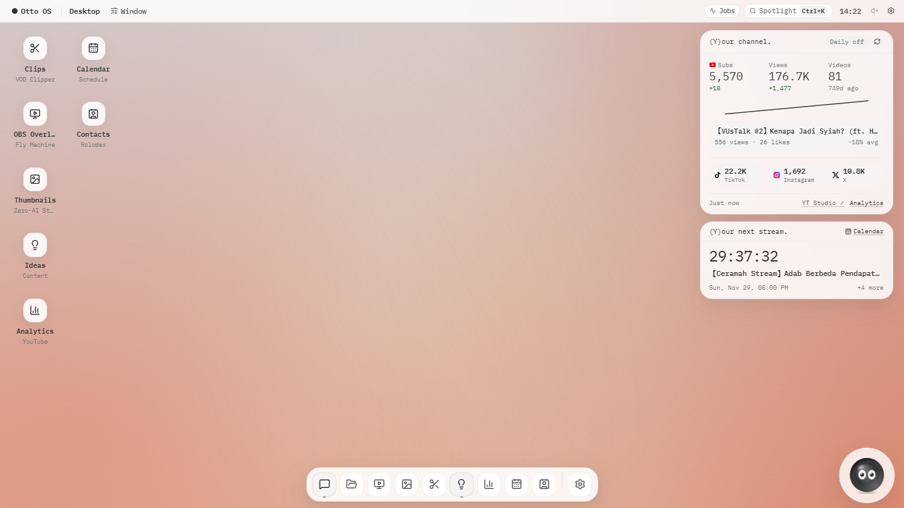
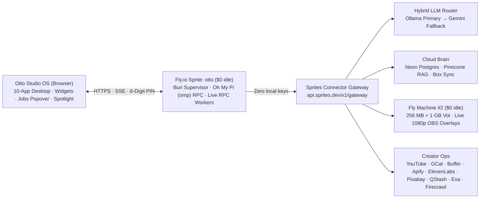
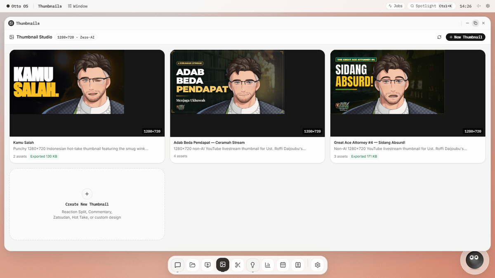
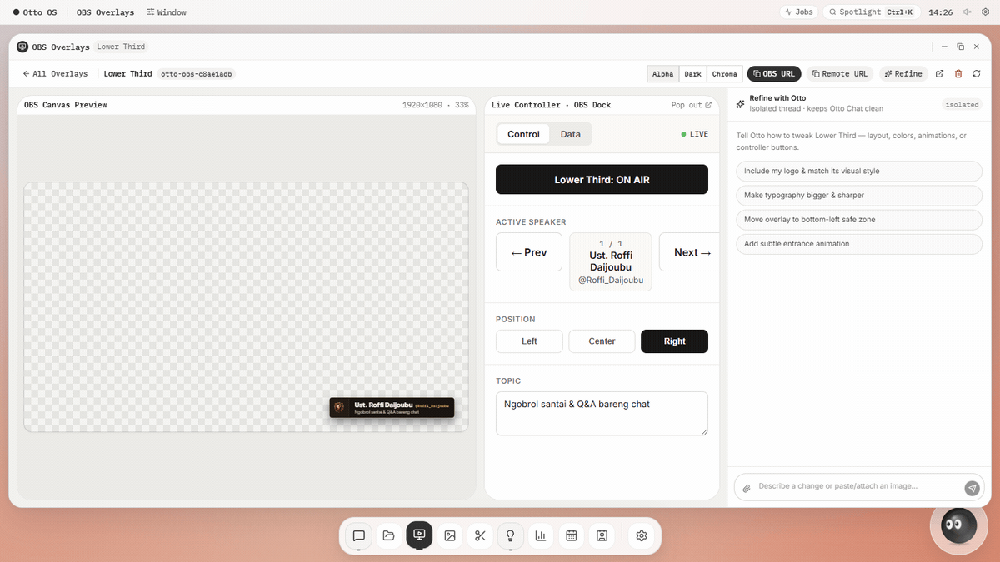
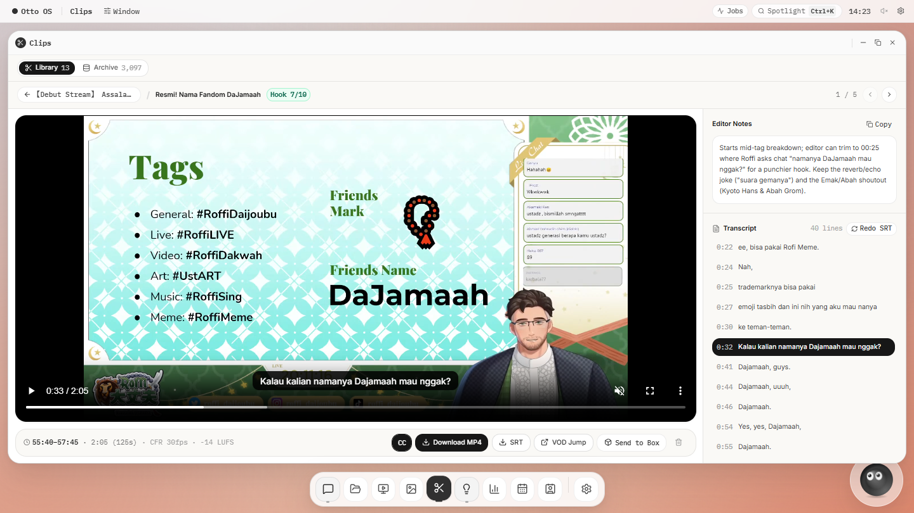
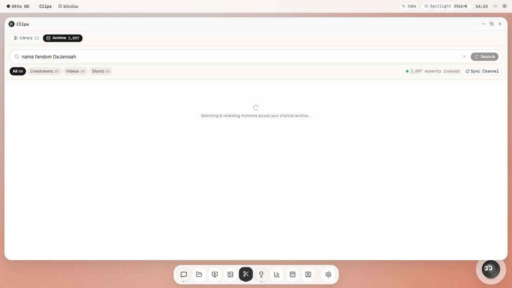
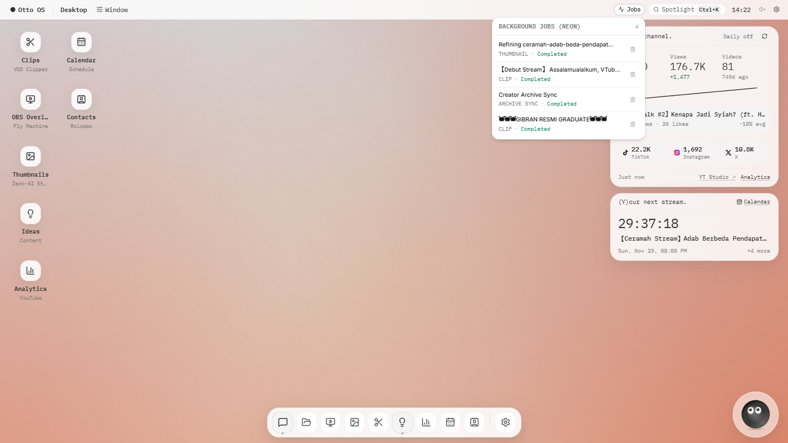
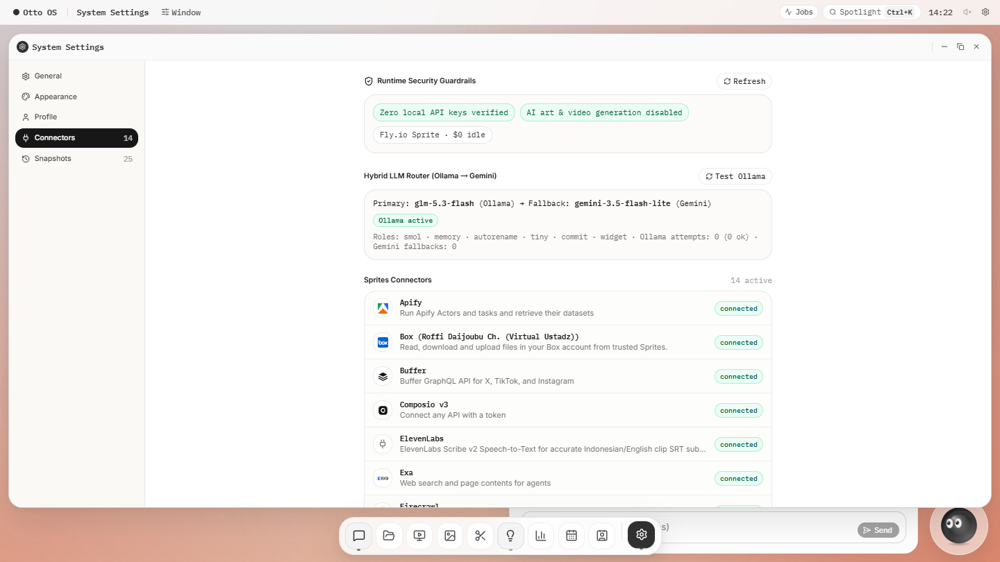

<p align="center">
  
</p>

<h1 align="center">Otto OS — Cloud Studio OS &amp; Livestreamer Manager Agent</h1>

<p align="center">
  <b>Otto OS turns one $0-idle Fly.io Sprite into a 10-app Cloud Studio OS for solo livestreamers — with a second auto-stop Fly Machine hosting live OBS overlays, a Neon + Pinecone cloud brain, live-nudgeable RPC background workers, zero-AI thumbnail composition, and 14 zero-key Sprites Connectors.</b>
  <br>
  Powered by <a href="https://github.com/can1357/oh-my-pi">Oh My Pi (<code>omp</code>)</a> on <a href="https://sprites.dev">Fly.io Sprites</a> &amp; Sprites Connectors · Built for <a href="https://fly.io/hacksgiving">Fly.io Hacksgiving 2026</a>.
</p>

<p align="center">
  
  
  
  
  
</p>

<p align="center">
  
  <br>
  <sub><b>Otto Studio OS</b>: a 10-app cloud desktop inside one Fly.io Sprite (Otto Chat, Clips &amp; Creator Archive, Thumbnail Studio, OBS Overlays, Studio Files, Ideas, Multi-Platform Analytics, Calendar, Contacts, System Settings) with live Desktop Widgets, TopMenuBar Background Jobs popover, unlimited installable Custom Studio Apps, <code>Cmd+K</code> Spotlight, and 6-digit PIN sign-in. <i>Live instance is PIN-protected to guard private OAuth/API quotas — demo PIN is included in the Hacksgiving submission form, or deploy your own in 1 prompt below.</i></sub>
</p>

<br>

---

## The Solo Streamer Burnout Trap

You boot up OBS, stream for five hours straight, and close the broadcast exhausted. There is no YouTube video ready to cut, no timestamped index of the best moments you just lived through, and no one keeping your schedule, packaging, or human editor handoffs moving.

Meanwhile, most "AI creator tools" try to replace the exact craft your community actually loves — churning out uncanny AI thumbnails, slop overlays, and synthetic clips that alienate viewers and undercut the human artists, riggers, clippers, and editors who keep indie streaming alive.

**Otto OS turns one `$0`-idle Fly.io Sprite into a persistent Cloud Studio OS and practical talent manager — automating research, clipping, thumbnails, overlays, and scheduling while keeping 100% of your art and video human-made.**



- **`$0` idle, still proactive.** Signed QStash wake-ups plus a `/.sprite/api.sock` Tasks API hold (5-minute heartbeat, hard 30-minute ceiling) fire pre-stream reminders, daily multi-platform metric snapshots, and daily Sprite auto-checkpoints while the Sprite sleeps ([`agent/extensions/qstash-scheduler.ts`](agent/extensions/qstash-scheduler.ts)).
- **Survives Sprite resets with zero data loss.** All 10 studio tables and `MEMORY.md` persist in **Neon Serverless Postgres** (with SQLite fallback), semantic memory and searchable video transcripts live in **Pinecone**, and assets/handoffs sync incrementally with **Box** ([`agent/lib/studio-db.ts`](agent/lib/studio-db.ts), [`agent/lib/cloud-memory.ts`](agent/lib/cloud-memory.ts)).
- **Real craft, never AI art slop.** `generate_image: deny` is enforced in tool policy, not prose. Thumbnails combine your real **Box** character cutouts, code-crafted CSS/SVG, and verified human photography from **Pixabay**, then visually self-inspect via headless Chrome ([`agent/extensions/thumbnails.ts`](agent/extensions/thumbnails.ts)).
- **Full UI ↔ Otto parity.** Everything a creator can click in the 10-app desktop — including inspecting, **nudging mid-flight**, resuming, or cancelling background workers — Otto can execute directly across **85 registered tools** ([`agent/extensions/studio-jobs.ts`](agent/extensions/studio-jobs.ts)).

<br>

---

## Feature Showcase

### 1. Zero-AI Thumbnail Studio + Headless Visual Self-Check

Compose `1280×720` HTML/CSS thumbnails using real creator cutouts from Box `Otto Assets/`, CSS/SVG studio lighting, and non-AI Pixabay photography. Every background build runs an autonomous **headless Chrome `thumbnail_render` → multimodal `read` visual self-check loop** to catch face overlaps, framing flaws, or YouTube duration-badge collisions before saving — with 1-click Box handoff and direct YouTube Live waiting-room scheduling (`youtube_schedule_live_broadcast`).

<p align="center">
  
  <br>
  <sub><b>Thumbnail Studio</b>: gallery of non-AI 1280×720 projects → full canvas with YouTube duration Safe Zone, 120px Mobile Squint Test, isolated Refine sidebar, and 1-click Box handoff.</sub>
</p>

<br>

### 2. Two Machines, One Studio — Live OBS Overlays

A live OBS Browser Source cannot sleep when the agent does. `obs_overlay_deploy` drives the **Fly Machines API** directly: `POST /v1/apps`, shared IPv4 + IPv6, a `1 GB` Fly Volume, and a `256 MB` `shared-cpu-1x` Bun host injected via `config.files` — **zero Dockerfile, zero image build** — with `autostart: true`, `autostop: "stop"`, `min_machines_running: 0`. Control scenes, timers, and text live from the side-by-side OBS-dock controller or directly from Otto Chat over SSE ([`agent/lib/obs-overlays.ts`](agent/lib/obs-overlays.ts)).

<p align="center">
  
  <br>
  <sub><b>Two Machines, One Studio</b>: transparent 1920×1080 OBS canvas served by auto-stop Fly Machine #2 (<code>otto-obs-c8ae1adb</code>), driven live via SSE from the side-by-side OBS-dock controller.</sub>
</p>

<br>

### 3. Deterministic VOD Clipper + Live SRT Viewer

Instead of feeding 4-hour VODs blindly into an LLM, a 12-thread InnerTube chat pull computes 4 rolling Z-scores with a 60-second pre-roll and 45-second post-roll, cuts full-arc clips, normalizes them to `-14 LUFS` CFR 30fps, transcribes word-level `.srt` captions via **ElevenLabs Scribe v3 + Gemini 3.5 Flash-Lite polish**, and runs a 480p/2fps FFmpeg multimodal hook review. Browse clips in a 3-page `VOD → Clips → Clip Viewer` UI with live SRT overlay, Redo SRT, and 1-click **Box** handoff for human editors ([`web/lib/clip-worker.ts`](web/lib/clip-worker.ts)).

<p align="center">
  
  <br>
  <sub><b>Clips Viewer</b>: normalized CFR 30fps / −14 LUFS clip with live synced ElevenLabs Scribe SRT overlay, Hook Score, Editor Notes, Redo SRT, and 1-click Box handoff.</sub>
</p>

<br>

### 4. Creator Archive — Pinecone Semantic Video Memory

Every YouTube video, livestream VOD, and Short on the channel is chunked and indexed into a zero-key **Pinecone** serverless index (`multilingual-e5-large` + `bge-reranker-v2-m3`). Browse all indexed streams by category (`All / Livestreams / Videos / Shorts`) or search any topic or quote in Indonesian or English to jump to the exact YouTube timestamp — or hand that moment straight into the Clipper ([`agent/lib/pinecone-archive.ts`](agent/lib/pinecone-archive.ts)).

<p align="center">
  
  <br>
  <sub><b>Creator Archive</b>: browse 80 indexed videos &amp; livestreams (3,097 moments) or run bilingual semantic search to jump straight to timestamps and clip moments.</sub>
</p>

<br>

### 5. Unified Resumable Jobs Queue + Live RPC Worker Nudging

Long-running Clips, Thumbnails, OBS Overlays, and Archive Sync jobs run in isolated **`omp --mode rpc`** workers tracked in Neon `studio_jobs` and surfaced in the TopMenuBar Jobs popover. Because every worker keeps an open RPC stdin pipe in an in-memory registry, Otto can **peek live tool telemetry** (`studio_job_inspect`), **steer a running worker mid-flight without killing it** (`studio_job_nudge`), or resume failed jobs from saved checkpoints (`studio_job_resume`) ([`web/lib/rpc-worker.ts`](web/lib/rpc-worker.ts), [`agent/extensions/studio-jobs.ts`](agent/extensions/studio-jobs.ts)).

<p align="center">
  
  <br>
  <sub><b>Unified Neon Jobs Queue</b>: TopMenuBar popover tracking Thumbnails, Clips, OBS Overlays, and Archive Sync workers — all inspectable and nudgeable mid-flight by Otto over RPC.</sub>
</p>

<br>

### 6. Zero-Key Cloud Brain, Hybrid LLM Router & Time-Travel Checkpoints

System Settings surfaces live security guardrails (`zeroLocalKeys`, `aiMediaDisabled`), **14 zero-key Sprites Connectors**, the **Hybrid LLM Router** (Ollama-first with automatic circuit-breaker failover to Gemini), and a **Sprite Time-Travel Checkpoints** UI backed by Fly.io copy-on-write snapshots and daily QStash auto-snapshots ([`web/lib/llm-router.ts`](web/lib/llm-router.ts), [`web/lib/checkpoints.ts`](web/lib/checkpoints.ts)).

<p align="center">
  
  <br>
  <sub><b>System Settings</b>: live security guardrails, Ollama → Gemini Hybrid LLM Router status, 14 zero-key Sprites Connectors, and 25 Time-Travel Checkpoints.</sub>
</p>

<br>

---

## Verifiable Engineering Scorecard

Every number below is backed directly by source files in this repository:

| Rubric Axis | Exact Code-Backed Proof | Source |
| :--- | :--- | :--- |
| **Fly.io Primitive Depth (5/5)** | **`sprite-env services` runtime** (idempotent `lma-web` on `:8080`, auto-restart) + **14 zero-key Sprites Connectors** (`/v1/gateway/list` runtime discovery) + `/.sprite/api.sock` Tasks API hold (5m heartbeat, 30m cap) + `<1s` QStash wake-up from `$0` sleep + CoW **Time-Travel Checkpoints** (UI + daily QStash + optional `scripts/install-hooks.sh` post-commit hook installed by `setup.sh` in git checkouts) + zero-Docker **Fly Machine + 1 GB Fly Volume** auto-stop OBS overlay host | [`agent/extensions/`](agent/extensions), [`agent/lib/obs-overlays.ts`](agent/lib/obs-overlays.ts), [`web/lib/checkpoints.ts`](web/lib/checkpoints.ts), [`scripts/sync-initialized-checkpoint.sh`](scripts/sync-initialized-checkpoint.sh) |
| **Concrete System Scope** | **22 extensions**, **85 registered tools** (full UI↔Otto parity + live RPC worker nudging), **9 skills**, **10 Neon Postgres / SQLite tables**, **10 wired Desktop OS apps** + Desktop Widgets + dynamic Custom Studio Apps, **17 modular route files (157 route branches)** — **144 vendored `shadcn-vue` primitives vs 50 hand-written `web/src` files** | [`agent/extensions/`](agent/extensions), [`agent/lib/studio-db.ts`](agent/lib/studio-db.ts), [`web/routes/`](web/routes), [`web/src/components/`](web/src/components) |
| **Security &amp; Isolation** | Live `zeroLocalKeys` + `aiMediaDisabled` telemetry; salted `scrypt` PIN hash (`LMA_WEB_PASSWORD_HASH`) in `chmod 600 ~/.config/lma/web.env` + random 256-bit server-side session cookies (`HttpOnly`, `SameSite=Lax`, `Secure` over HTTPS) + `fly-client-ip` 5/min limiter; explicit `child-env` allowlist stripping auth/webhook/DB secrets from `omp` (note: `omp` runs as the same `sprite` UID in `yolo` mode, so hashed PIN + random session IDs prevent direct credential theft; multi-user deployments should isolate the agent under a separate OS user); dual-key QStash JWT + SHA-256 body hash; `realpathSync` symlink-denying jail + 48 MiB Box guard + pull-only boot Box sync (`Otto Assets/`; pushes to `Otto Handoffs/` only on explicit action); DNS-resolving IPv4/IPv6 HTTPS SSRF guard with redirect re-validation; read-only SQL allowlist; 128-bit CSPRNG capability token + `event.source` validation + opaque `sandbox="allow-scripts"` iframe for Custom Studio Apps; strict `script-src 'none'` CSP on Thumbnail previews &amp; sandboxed SVG/OBS overlay iframes | [`web/lib/auth.ts`](web/lib/auth.ts), [`web/lib/workspace.ts`](web/lib/workspace.ts), [`web/src/lib/studio-app-sandbox.ts`](web/src/lib/studio-app-sandbox.ts), [`agent/lib/box-sync.ts`](agent/lib/box-sync.ts) |
| **Deterministic Systems Craft** | 12-thread InnerTube parallel chat pull (~30s/4h VOD); 4-signal rolling Z-score + 60s pre-roll / 45s post-roll; ElevenLabs Scribe v3 + Gemini 3.5 Flash-Lite SRT polish; `-14 LUFS` CFR 30fps prep; headless Chrome `thumbnail_render` + visual self-inspection loop; Ollama→Gemini circuit-breaker failover; 2-way Google Calendar + native reminders + RFC 5545 `.ics` `VALARM`s | [`agent/skills/raw-clip-finder/scripts/`](agent/skills/raw-clip-finder/scripts), [`agent/lib/elevenlabs-stt.ts`](agent/lib/elevenlabs-stt.ts), [`web/lib/llm-router.ts`](web/lib/llm-router.ts), [`agent/extensions/calendar.ts`](agent/extensions/calendar.ts) |
| **Reproducible Verification** | **28 deterministic fast checks** (~10s against live `:8080` Sprite service) + `--live` (live zero-key connector round-trip) + **5 multi-turn E2E playbooks** graded against golden [`expected-memory.md`](scripts/e2e/expected-memory.md) via Sprite Checkpoint time-travel | [`scripts/verify-all.sh`](scripts/verify-all.sh), [`scripts/e2e/`](scripts/e2e) |

**Recompute every number above** — no trust required: `ls agent/extensions/*.ts | wc -l` → 22 · `grep -h "pi.registerTool" agent/extensions/*.ts | wc -l` → 85 · `ls -d agent/skills/*/ | wc -l` → 9 · `grep -c "CREATE TABLE" agent/lib/studio-db.ts` → 10 · `grep -cE '^    id: "' web/src/composables/useWindowManager.ts` → 10 · `grep -hE 'url\.pathname' web/routes/*.ts | wc -l` → 157 · `expr $(grep -c 'check_grep "' scripts/verify-all.sh) + 1` → 28 · `ls scripts/e2e/0*.md | wc -l` → 5 · `git ls-files 'web/src/components/ui/*' | wc -l` → 144.

<br>

---

## Replicate This Setup in 1 Prompt

Already using Claude Code, `omp`, Pi, or Codex? Hand it this prompt to spin up your own **Otto OS** Sprite — zero manual config editing required:

```text
Set me up with my own "Otto" personal Cloud Studio OS & Livestreamer Manager agent on Fly.io Sprites:
1. Follow https://fly.io/sprites/agent-ready.md to verify the Sprite CLI and Fly.io auth.
2. Create a Sprite named "otto" and set it active (`sprite create --skip-console otto && sprite use otto`).
3. Inside the Sprite, clone https://github.com/roffidaijoubu/otto.git into ~/lma and run `bash ~/lma/setup.sh` (installs omp, ffmpeg, yt-dlp, symlinks agent config/extensions, builds web/, registers lma-web, and generates a 6-digit PIN).
4. Inside the Sprite, check `curl -s https://api.sprites.dev/v1/gateway/list` and follow `docs/setup/README.md` to provision any missing Sprites Connectors (then re-run `bash ~/lma/setup.sh`):
   - Required: Google Gemini (LLM + multimodal review).
   - Optional zero-key connectors: Neon Postgres, Pinecone, Box, ElevenLabs, Pixabay, Ollama, Exa, Firecrawl, Composio v3 (YouTube + GCal), Buffer (X/TikTok/IG), Apify, Upstash QStash, and Fly Machines (OBS Overlays).
   - Do as much as possible via CLI; only ask me when you need an API key, OAuth click, or if a CLI step fails.
```

> **Zero outbound API keys:** All third-party API keys and OAuth tokens stay inside Fly.io's encrypted organization gateway — never inside the Sprite VM or this repository. `setup.sh` auto-generates your 6-digit Web UI PIN in `chmod 600 ~/.config/lma/web.env` and auto-discovers every authorized connector at runtime.

### Manual Setup (4 Commands)

```bash
# 1. Create and select your persistent Sprite
sprite create --skip-console otto && sprite use otto

# 2. Add the required Google Gemini connector in https://sprites.dev -> Connectors
#    (and grant access to your `otto` Sprite)

# 3. Clone the repo inside the Sprite and run the idempotent installer
sprite exec -- bash -c "git clone https://github.com/roffidaijoubu/otto.git ~/lma && bash ~/lma/setup.sh"
#    (setup.sh prints your auto-generated 6-digit Web UI PIN stored in ~/.config/lma/web.env)

# 4. Open Otto Studio OS at https://<your-sprite>.sprites.app
#    (or chat directly from your terminal via: sprite console && omp)
```

<br>

---

## How 14 Zero-Key Sprites Connectors Power Otto

Every external API routes through the organization-level [Fly.io Sprites Connector Gateway](https://docs.fly.io/sprites/concepts/connectors.md) and auto-discovers its `gateway_base_url` via `GET /v1/gateway/list` at runtime:

| Connector | Role in Otto OS | Source |
| :--- | :--- | :--- |
| **Google Gemini** | Primary reasoning (`gemini-4-hydrogen:auto`), multimodal review, &amp; SRT typo polish | [`agent/config.yml`](agent/config.yml) |
| **Ollama Cloud** | Primary low-latency endpoint for smol/memory/widget roles via Hybrid LLM Router circuit-breaker | [`web/lib/llm-router.ts`](web/lib/llm-router.ts) |
| **Neon Postgres** | Cloud-persistent 10-table Studio DB + `MEMORY.md` sync (SQLite fallback) | [`agent/lib/studio-db.ts`](agent/lib/studio-db.ts) |
| **Pinecone** | `otto-creator-archive` (`multilingual-e5-large` + `bge-reranker-v2-m3`) &amp; `otto-memory` | [`agent/lib/pinecone-archive.ts`](agent/lib/pinecone-archive.ts) |
| **Fly Machines** | Zero-Docker provisioning of dedicated `256 MB` auto-stop OBS Overlay host + `1 GB` Volume | [`agent/lib/obs-overlays.ts`](agent/lib/obs-overlays.ts) |
| **ElevenLabs** | Scribe v3 word-level `.srt` transcription for VOD clips | [`agent/lib/elevenlabs-stt.ts`](agent/lib/elevenlabs-stt.ts) |
| **Box** | Incremental `Otto Assets/` pull + `Otto Handoffs/` push (48 MiB guard) + 1-click editor handoff | [`agent/lib/box-sync.ts`](agent/lib/box-sync.ts) |
| **Composio v3** | YouTube Data/Live Broadcasts (`youtube_schedule_live_broadcast`) + 2-way Google Calendar &amp; reminders | [`agent/extensions/composio-youtube.ts`](agent/extensions/composio-youtube.ts) |
| **Buffer** | Draft-first per-channel social publishing (`x_post`, `tiktok_post`, `instagram_post`) | [`agent/lib/buffer.ts`](agent/lib/buffer.ts) |
| **Apify** | Credit-capped TikTok, Instagram &amp; X research + multi-platform analytics sync | [`agent/lib/apify.ts`](agent/lib/apify.ts) |
| **Pixabay** | Royalty-free, strictly non-AI human photography backgrounds for Thumbnail Studio | [`agent/extensions/pixabay.ts`](agent/extensions/pixabay.ts) |
| **Upstash QStash** | Proactive `CRON_TZ` wake-ups, daily metrics sync &amp; daily Sprite auto-snapshots | [`agent/extensions/qstash-scheduler.ts`](agent/extensions/qstash-scheduler.ts) |
| **Exa** | Semantic web research (`exa_search`, `exa_get_contents`) | [`agent/extensions/exa-gateway.ts`](agent/extensions/exa-gateway.ts) |
| **Firecrawl** | Clean Markdown web scraping (`firecrawl_scrape`) | [`agent/extensions/firecrawl-gateway.ts`](agent/extensions/firecrawl-gateway.ts) |

<br>

---

## Architecture &amp; Deep Dives

- **Architecture Deep Dive:** [`docs/architecture.md`](docs/architecture.md) — `omp` RPC supervisor, Two-Machine OBS architecture, 12-thread InnerTube chat-pull math, and defense-in-depth security model.
- **Agent-First Setup Guides:** [`docs/setup/README.md`](docs/setup/README.md) — provisioning playbooks for all 14 Sprites Connectors + `verify-all.sh` prerequisites, plus deep-dive guides in `docs/setup/`.
- **Design System:** [`DESIGN.md`](DESIGN.md) — Otto Studio Bento OS tokens &amp; `shadcn-vue` / Reka UI desktop window rules.
- **Verification &amp; E2E Playbooks:** [`scripts/verify-all.sh`](scripts/verify-all.sh) (28 deterministic checks) &amp; [`scripts/e2e/INDEX.md`](scripts/e2e/INDEX.md) (5 Checkpoint Time-Travel behavioral playbooks).

<br>

---

## Built By &amp; Acknowledgements

- **Built by [Roffi Daijoubu](https://www.youtube.com/@roffi_daijoubu)** ([@Roffi_Daijoubu](https://x.com/Roffi_Daijoubu)) — an indie VTuber from Indonesia who built **Otto OS** to solve a real solo-creator bottleneck: keeping stream prep structured, thumbnails human-crafted, social promos consistent, and raw VOD clips ready for human clippers and editors — without burning out or ever touching AI-generated art or video.
- **Powered by [Oh My Pi (`omp`)](https://github.com/can1357/oh-my-pi):** Otto runs on `omp` as its persistent agent runtime (RPC supervisor, live RPC background workers, extensions, skills, and memory) — and the stylized `tt` in the Otto logo is a direct nod to the Oh My Pi mark.
- **Optional Coaching Skill Acknowledgement:** The opt-in `streaming-coaching` skill (activated only if a creator explicitly asks for streaming strategy or growth advice) is inspired by **[Ludwig Ahgren](https://www.youtube.com/@ludwig)**'s *Professor L* curriculum at **Streamer University** — specifically his [*"How to Get Lucky"* lecture](https://youtu.be/sXRtZaK1Nlw). *(Independent fan-built project; not affiliated with or endorsed by Ludwig Ahgren or Mogul Moves.)*

<br>

---

<p align="center">
  <a href="docs/architecture.md">Architecture Deep Dive</a> · <a href="docs/setup/README.md">Agent Setup Guides</a> · <a href="DESIGN.md">Design System</a> · <a href="AGENTS.md">Agentic Workflow</a> · <a href="https://fly.io/hacksgiving">Fly.io Hacksgiving</a>
</p>

<p align="center">
  <sub>MIT License</sub>
</p>
