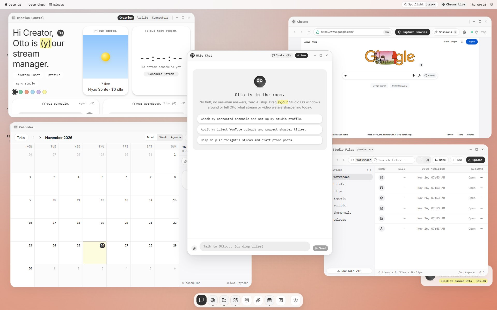
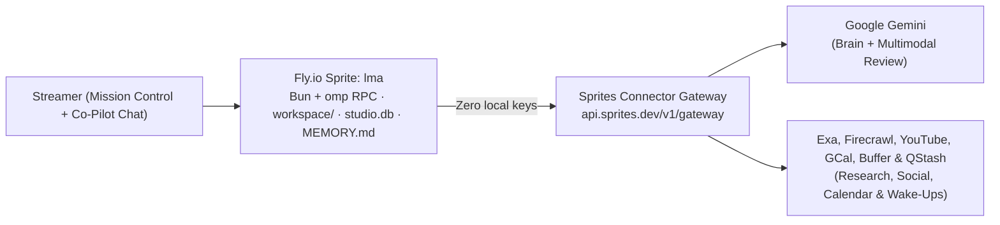

<h1 align="center">LMA — Livestreamer Manager Agent</h1>

<p align="center">
  <b>Otto is a self-hosted talent manager inside a Fly.io Sprite that schedules its own wake-ups, learns your channel overnight with your approval, turns VODs into human-editor-ready clips with deterministic math, and never generates a single pixel of AI art.</b>
  <br>
  Built for <a href="https://fly.io/hacksgiving">Fly.io Hacksgiving 2026</a> on <a href="https://sprites.dev">Sprites</a>, <a href="https://github.com/can1357/oh-my-pi">omp</a>, and Sprites Connectors.
</p>

<p align="center">
  
  
  
  
</p>

<p align="center">
  
  <br>
  <sub><b>Otto Studio Bento OS</b>: personal creative-studio desktop with 3D cursor-tracking pure-SVG Otto mascot, 3-step first-run Setup Wizard (400+ IANA timezones), live next-stream countdown, 2-way Google Calendar + QStash wake-ups, Learned Creator Playbooks approval queue, Unified 2-way Workspace &amp; Clips, Unified SQLite Studio DB, Zero-Key Connectors, and docked Otto Co-Pilot Chat. <i>Live instance is passcode-protected to protect private OAuth/API quotas — demo credentials are provided privately in the Hacksgiving submission form, or deploy your own in 1 prompt below.</i></sub>
</p>

<br>

---

```text
╭─ sprite: lma · google/gemini-4-hydrogen · mnemopi ────────────────────────────╮
│                                                                               │
│  you › Plan tonight's 2-hour gaming stream, lock it on my calendar at 20:00,  │
│        and draft promo posts. Also can you generate an AI thumbnail?          │
│                                                                               │
│  lma › Hard no on AI thumbnails — keep your visuals human-made. Here's a      │
│        tight brief you can hand straight to your artist instead.              │
│                                                                               │
│        Everything else is done:                                               │
│          1. Run-of-show saved to Studio Files (/scripts) & Content Pipeline   │
│          2. Added to Calendar + synced to Google Calendar (T-1h check-in set) │
│          3. Tailored X, TikTok & IG announcements queued as Buffer Drafts     │
│                                                                               │
╰───────────────────────────────────────────────────────────────────────────────╯
```

<br>

---

## The Solo Streamer Burnout Trap

You boot up OBS, stream for seven hours straight because you have the time, and close the broadcast exhausted. There is no YouTube video waiting to be cut, no clear segment structure, and no one holding you accountable when your packaging slips or your schedule bleeds into burnout.

Meanwhile, most "AI creator tools" try to replace the exact craft your community actually loves — churning out uncanny AI thumbnails, slop overlays, and synthetic clips that alienate viewers and undercut the human artists, riggers, clippers, and editors who keep streaming alive.

**`lma` puts a practical livestreamer manager & ops agent inside a persistent Fly.io Sprite — automating research, prep, clipping, and scheduling while keeping 100% of your art and video human-made.**



- **1. An agent that learns your channel — not the internet's (Hermes Nightly Self-Learning):** A timezone-aware Upstash QStash cron (`CRON_TZ=<IANA> 0 0 * * *`) fires a signed `POST /api/wakeup` that spawns an isolated `omp --no-session` reflection pass (with secrets stripped from env) over recent sessions, `MEMORY.md`, and `studio.db`. Otto drafts channel-specific SOPs as `pending` (with 16 KiB / 30-skill caps and a prompt-injection denylist) for 1-click Approve/Reject in the **Playbooks** tab (`LearnedPlaybooksCard`) before Otto consults them via `learned_skills_*`.
- **2. Proactive ops on a $0-idle sleeping VM:** `schedule_wakeup` / `list_wakeups` / `cancel_wakeup` publish one-shot or cron jobs to QStash — including lifecycle presets (`promo_24h`, `pre_stream_1h`, `post_stream_vod_3h`) that automatically re-arm when an event is rescheduled. Signed inbound webhooks wake the sleeping Sprite in `<1s` and hold the `/.sprite/api.sock` Tasks API alive (capped at 30 min) so long turns never get cut off.
- **3. VOD → human-editor-ready clips, with zero LLM guessing:** `vod_scan_hype` fetches YouTube InnerTube live-chat replay + `yt-dlp` transcripts in parallel, then runs a **zero-LLM** Python detector (`detect_hype_candidates.py`) that buckets chat into 10-second windows and scores 4 rolling Z-score signals (velocity `0.40`, unique-author burst `0.30`, reaction ratio `0.15`, emote burst `0.15`) to surface real hype peaks. `vod_cut_clip` + `vod_prep_clip` output exact `.mp4` + time-shifted `.srt` normalized to CFR 30fps H.264 `+faststart` at broadcast **-14 LUFS**.
- **4. One shared brain for human and agent:** Both Otto Studio OS and Otto read/write the exact same SQLite WAL database (`~/.omp/agent/studio.db` — 8 tables, 14 agent tools, live SSE auto-refresh for Schedule, Content Pipeline, Human Team &amp; Collab Contacts, Channel Metrics, Custom Trackers &amp; Learned Playbooks), the same two-way `/home/sprite/workspace/` file manager (drag-drop &amp; chat `📎` uploads, Range/206 media streaming, atomic Markdown editing, 500 MB ZIP export), and two-way Google Calendar + `.ics` sync.
- **5. Watch it think, watch it plan, zero cold start:** Token-level SSE streaming renders live `<ThoughtTrace>` reasoning with human-readable tool labels plus Otto's own live `TodoChecklistCard`, while `<hidden>` directives keep internal paths out of chat. On first launch, a 3-step **Setup Wizard** (400+ IANA timezone catalog, atomic `0600` passcode rotation, live connector checklist) and one-time **OAuth Dossier Auto-Bootstrap** pre-fill your channel profile before your first message — fronted by a 3D cursor-tracking pure-SVG **Otto mascot**.
- **6. A hard ethical stance, enforced in code:** Strictly no AI-generated images or video at both the persona layer (`agent/APPEND_SYSTEM.md`) and tool-permission layer (`generate_image: deny`), backed by live computed guardrail telemetry (`zeroLocalKeys`, `aiMediaDisabled`). Every key-bearing external call routes through zero-key [Fly.io Sprites Connectors](https://docs.fly.io/sprites/concepts/connectors.md), and 1-click **Review Thumbnail / Review Clip** sends your real thumbnail or clip (with SSRF/size caps and 480p proxy transcoding) to Gemini multimodal review to write sharper briefs for human artists and editors.
- **7. Reproducible agentic engineering:** Every `git commit` snapshots live prod state and stamps a spotless `initialized: <sha>` Fly.io Sprite checkpoint; `scripts/verify-all.sh` runs **27 deterministic checks** (auth gates, path-traversal rejections, `CRON_TZ`, learned-skill injection rejection, DB/workspace CRUD) in ~10s alongside 5 multi-turn E2E playbooks (`scripts/e2e/`).
<br>

---

## Replicate This Setup With Your Coding Agent

Already using Claude Code, `omp`, Pi, or Codex? Hand it this prompt to spin up your own `lma` Sprite in under a minute — no manual config editing required:

```text
Set me up with my own "lma" personal Livestreamer Manager agent on Fly.io Sprites:
1. Follow https://fly.io/sprites/agent-ready.md to verify the Sprite CLI and Fly.io auth.
2. Create a Sprite named "lma" and set it active (`sprite create --skip-console lma && sprite use lma`).
3. Inside the Sprite, clone this repo into ~/lma and run `bash ~/lma/setup.sh` (installs omp, ffmpeg, yt-dlp, symlinks agent config/extensions, and initializes MEMORY.md).
4. Inside the Sprite, check `curl -s https://api.sprites.dev/v1/gateway/list` and follow `docs/setup/README.md` to provision any missing Sprites Connectors (then re-run `bash ~/lma/setup.sh` so `~/.omp/agent/models.yml` is written):
   - Required: Google Gemini (for LLM + multimodal review). Optional built-ins: Exa, Firecrawl.
   - Optional Custom API connectors via `sprite api`: `docs/setup/composio-youtube.md` (YouTube), `docs/setup/buffer.md` (X/TikTok/IG), `docs/setup/qstash-scheduler.md` (proactive wake-ups).
   - Do as much as possible via CLI; only ask me when you need an API key, OAuth click, or if a CLI step fails.
```

> **Zero outbound API keys:** All 6 third-party API keys stay in Fly.io's encrypted organization gateway — never inside the Sprite VM or this repo. `setup.sh` auto-generates your private Web UI passcode in `chmod 600 ~/.config/lma/web.env` and auto-discovers every authorized connector at runtime.

<br>

---

## Manual Setup (4 Commands)

Prefer to run it directly from your terminal?

```bash
# 1. Create and select your persistent Sprite
sprite create --skip-console lma && sprite use lma

# 2. Add the required Google Gemini connector in https://sprites.dev -> Connectors
#    (and grant access to your `lma` Sprite)

# 3. Clone the repo inside the Sprite and run the idempotent installer
sprite exec -- bash -c "git clone https://github.com/roffidaijoubu/lma.git ~/lma && bash ~/lma/setup.sh"
#    (setup.sh prints your auto-generated Web Chat UI passcode stored in ~/.config/lma/web.env)

# 4. Open Otto Studio Web UI at https://<your-sprite>.sprites.app
#    (or chat directly from your terminal via: sprite console && omp)
```

<br>

---

## How Sprites Connectors Power `lma`

`lma` never stores `GEMINI_API_KEY`, `EXA_API_KEY`, or `FIRECRAWL_API_KEY` inside the Sprite. Each capability connects through the organization-level Sprites Gateway:

| Connector | Role in `lma` | Discovery Mechanism |
| :--- | :--- | :--- |
| **Google Gemini** | LLM brain (`gemini-4-neon`, `gemini-4-hydrogen`, `gemini-3.5-flash-lite`) | Auto-written to `~/.omp/agent/models.yml` by `setup.sh` |
| **Exa** | First-class `exa_search` & `exa_get_contents` research tools | Auto-discovered at runtime via `agent/extensions/exa-gateway.ts` |
| **Firecrawl** | First-class `firecrawl_scrape` clean Markdown scraper | Auto-discovered at runtime via `agent/extensions/firecrawl-gateway.ts` |
| **YouTube (Composio v3)** | Channel stats, recent videos, captions &amp; packaging ops (`youtube_tool`) | Auto-discovered Custom API connector ([setup guide](docs/setup/composio-youtube.md)) |
| **Buffer (X / TikTok / IG)** | Draft &amp; schedule posts across X, TikTok, and Instagram (`buffer_create_post`) | Auto-discovered Custom API connector ([setup guide](docs/setup/buffer.md)) |
| **Upstash QStash** | Agent self-scheduled one-shot &amp; cron wake-ups (`schedule_wakeup`) | Auto-discovered Custom API connector ([setup guide](docs/setup/qstash-scheduler.md)) |

> All **connector** extensions (`buffer`, `composio-youtube`, `exa`, `firecrawl`, `media-reviewer`, `qstash-scheduler`) query `GET https://api.sprites.dev/v1/gateway/list` inside the Sprite and cache the authorized `gateway_base_url`, so the repository contains zero hardcoded connector IDs and works across any Fly.io organization out of the box. (`studio-db`, `vod-clipper`, `skill-learner`, and `new-session` are local-only.)

<br>

---

## Architecture & Key Files

Rather than turning `~/.omp/` into a messy git repo full of session logs and SQLite caches, `lma` keeps a clean source repository and symlinks only the agent definition into `~/.omp/agent/`:

| Path | Purpose |
| :--- | :--- |
| `agent/APPEND_SYSTEM.md` | Otto persona, pragmatic ops rules, strict no-AI-media guardrail, voice/character rules, and memory protocol |
| `agent/config.yml` | Gemini-only model roles, Mnemopi SQLite memory (`noEmbeddings: true`), and `generate_image: deny` |
| `agent/MEMORY.md.example` | Starter studio profile template: persona/timezone, platform baseline, topics/style, human team credits, OPSEC boundaries, and schedule notes |
| `agent/lib/studio-db.ts` | Shared SQLite WAL database (`~/.omp/agent/studio.db`) for Schedule, Content Pipeline, Contacts, Metrics &amp; Custom Trackers |
| `agent/extensions/*.ts` | 10 extensions exposing 38 auto-discovering `omp` tools for Exa, Firecrawl, Composio (YouTube + Google Calendar), Buffer, QStash, VOD clipper, media review, `studio-db`, learned playbooks, plus a `--new` CLI flag (`new-session.ts`) |
| `web/` | Vue 3 + Vite + DaisyUI v5 Studio Mission Control (`WorkspaceFileManager`, `StudioDatabaseView`, `TodoChecklistCard`, `ThoughtTrace`, chat `📎` uploads, `/api/workspace/*`, `/api/db/*`, `/api/calendar`, `/api/wakeup`) |
| `scripts/` | Auto-checkpoint sync (`sync-initialized-checkpoint.sh`), OAuth dossier bootstrap (`bootstrap-dossier.sh`), 26-check `verify-all.sh`, &amp; agentic E2E playbooks (`scripts/e2e/`) |
| `setup.sh` | Idempotent bootstrap: installs `omp`, `ffmpeg`, `yt-dlp`, scaffolds `/home/sprite/workspace/`, builds `web/`, registers `lma-web`, and auto-bootstraps Draft Talent Dossier |
### Why Fly.io Sprites Made Building `lma` 10× Faster
Beyond zero-key **Sprites Connectors** and $0-idle auto-sleep (paired with **Upstash QStash + `/.sprite/api.sock` Tasks API** for proactive wake-ups), **Sprites' copy-on-write Checkpoints** completely solved stateful agent testing:
- Every `git commit` auto-refreshes a spotless `initialized: <sha>` checkpoint (blank `MEMORY.md`, cleared Mnemopi/`studio.db`/`learned-skills`/`workspace/`, rebuilt `web/`).
- Any fresh coding agent can read [`scripts/e2e/INDEX.md`](scripts/e2e/INDEX.md), `sprite restore` back to `initialized:` in ~1 second, run multi-turn behavioral playbooks (`01-onboarding.md` … `05-qstash-proactive-wakeup.md`) grading Otto's live tool calls and memory against `expected-memory.md`, and jump right back to live prod state with zero data loss.

> **For judges &amp; engineers:** Read the full [Architecture Deep Dive (`docs/architecture.md`)](docs/architecture.md) for why we chose `omp --mode rpc --no-ui` over a custom agent loop, how proactive wake-ups survive 30s auto-sleep, and our defense-in-depth security model.
<br>

---

## Project Status

Built actively during **Fly.io Hacksgiving 2026**:

- ✅ Persistent Fly.io Sprite runtime (`omp` + Mnemopi SQLite + `MEMORY.md` dossier + OAuth auto-bootstrap) &amp; **Otto Studio Bento OS** Web UI (3-step Setup Wizard w/ 400+ IANA timezones, 3D cursor-tracking SVG Otto mascot, live stream countdown, live `<ThoughtTrace>` + `TodoChecklistCard` &amp; docked Co-Pilot Chat)
- ✅ **Hermes Nightly Self-Learning &amp; Learned Creator Playbooks** (`CRON_TZ` midnight QStash cron → isolated `omp --no-session` reflection → staged `pending` SOPs with anti-injection guardrails → dedicated **Playbooks** tab &amp; Overview bento card)
- ✅ Unified 2-way Studio Workspace (`/home/sprite/workspace/` with unified VOD `clips/`, drag-drop + chat `📎` uploads, Range/206 media preview, Markdown editor, folder ZIP export, and 1-click *Review Thumbnail* / *Review Clip*) + Unified SQLite WAL Studio DB (`~/.omp/agent/studio.db`, 8 tables, 14 agent tools, live SSE refresh)
- ✅ Zero-key Sprites Connectors for Gemini, Exa, Firecrawl, Composio v3 (YouTube + 2-way Google Calendar sync), Buffer (X/TikTok/IG), and Upstash QStash (proactive lifecycle wake-ups + `.ics` export) with live computed guardrail telemetry
- ✅ Otto persona, strict no-AI-art/video guardrails, 6 streamer skills (5 ops skills + opt-in `streaming-coaching` advice skill), zero-LLM 4-signal `vod-clipper` hype detector + raw `.mp4`/`.srt` cutter + `-14 LUFS` prep, &amp; zero-key Gemini `media-reviewer`
- ⚠️ Final Hacksgiving demo video &amp; submission — ready to record!
<br>

---

## Built By &amp; Acknowledgements

- **Built by [Roffi Daijoubu](https://www.youtube.com/@roffi_daijoubu)** ([@Roffi_Daijoubu](https://x.com/Roffi_Daijoubu)) — an indie VTuber from Indonesia who built `lma` to solve a real solo-creator bottleneck: keeping stream prep structured, titles sharp, social promos consistent, and raw VOD clips ready for human clippers and editors — without burning out or ever touching AI-generated art or video.
- **Optional Coaching Skill Acknowledgement:** The opt-in `streaming-coaching` skill (activated only if a creator explicitly asks for streaming strategy or growth advice) is inspired by **[Ludwig Ahgren](https://www.youtube.com/@ludwig)**'s *Professor L* curriculum at **Streamer University** — specifically his [*"How to Get Lucky"* lecture](https://youtu.be/sXRtZaK1Nlw). *(Independent fan-built project; not affiliated with or endorsed by Ludwig Ahgren or Mogul Moves.)*

<br>

---

<p align="center">
  <a href="docs/architecture.md">Architecture Deep Dive</a> · <a href="docs/setup/README.md">Agent Setup Guides</a> · <a href="DESIGN.md">Design System</a> · <a href="AGENTS.md">Agentic Workflow</a> · <a href="https://fly.io/hacksgiving">Fly.io Hacksgiving</a>
</p>

<p align="center">
  <sub>MIT License</sub>
</p>
