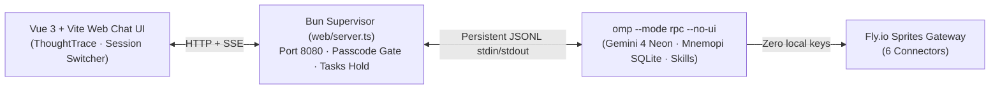
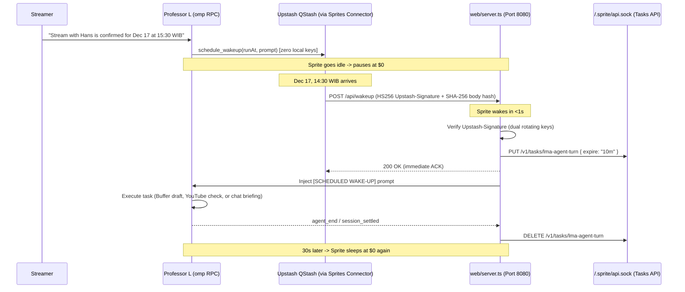

# Architecture Deep Dive — Why `lma` Uses `omp` RPC + Native Fly.io Sprites Primitives

This document explains the key engineering decisions behind **`lma`** — specifically why we chose **`omp` (`@oh-my-pi/pi-coding-agent`)** as the persistent agent engine, how we solved **proactive self-scheduling on a $0-idle sleeping Sprite**, and how we use **Sprites Connectors, Tasks API, and Checkpoints** together with zero API keys inside the VM.

---

## 1. Why `omp --mode rpc --no-ui` Instead of a Custom Agent Loop

Most hackathon agents reinvent a brittle `while (toolCalls)` loop in Python or TypeScript, then spend 80% of their time fighting context compaction, tool-call retries, session persistence, and streaming bugs.

`lma` takes the opposite approach: treat **`omp`** as the real, battle-tested agent runtime inside the Sprite, and wrap it with a thin Bun supervisor (`web/server.ts`) speaking **`omp --mode rpc --no-ui`** over newline-delimited JSON (JSONL) stdin/stdout.

### What `omp` RPC gives us out of the box
| Capability | How `lma` Uses It |
| :--- | :--- |
| **Zero per-message cold start** | One persistent `omp` RPC worker stays warm inside `lma-web` (auto-restarts on exit) instead of spawning a new CLI process per turn. |
| **First-class streaming events** | `thinking_delta`, `text_delta`, `tool_execution_start`, and `tool_execution_end` stream straight to the Vue 3 `<ThoughtTrace>` component over SSE. |
| **Native session management** | `get_messages`, `new_session`, `switch_session`, and `abort` power multi-chat history and instant stop controls without a custom chat database. |
| **Dual-layer persistent memory** | Structured `MEMORY.md` talent dossier (Goals, Schedule, 3 GOATs, 3+1 tracker) paired with built-in **Mnemopi** SQLite memory (`noEmbeddings: true` for fast CPU-only FTS recall). |
| **Clean `ExtensionAPI` + Skills** | Connectors live as small, auto-discovering TypeScript extensions (`agent/extensions/*.ts`); coaching workflows live as Markdown skills (`agent/skills/`). |
| **Tool-level guardrails** | `generate_image: deny` and `generate_image.enabled: false` enforce the **strictly no AI-generated art/video** rule at the runtime layer, not just in prose. |

---

## 2. Proactive Self-Scheduling on a Sleeping Sprite (Upstash QStash + Tasks API)

Fly.io Sprites pause automatically after **~30 seconds of idle time** (warm suspend → cold stop), which keeps idle compute at **$0** — but also pauses any local Linux `cron` daemon inside the VM.

To let Professor L be genuinely **proactive** (e.g., *"Remind me 1 hour before my collab stream on Dec 17 at 15:30 WIB, then pull the VOD afterward to cut raw clips"*), `lma` combines **Upstash QStash** with Fly.io's **`/.sprite/api.sock` Tasks API**:

### Why the `/.sprite/api.sock` Tasks API Hold Matters
Because `POST /api/wakeup` returns `200 OK` to QStash immediately and runs `omp` asynchronously, there is **no open browser SSE connection** during a headless wake-up. Without a keep-alive hold, a multi-tool agent turn taking >30 seconds could be paused mid-flight by the Sprite's idle detector.

Holding `PUT /v1/tasks/lma-agent-turn` (`expire: "10m"`) on `agent_start` and releasing `DELETE /v1/tasks/lma-agent-turn` on `agent_end`/`abort` guarantees every headless wake-up finishes cleanly — while the 10-minute TTL guarantees a crash can never leak billing.

---

## 3. Zero-Key Auto-Discovering Connectors (6 Connectors, 0 Secrets in VM)

Every external API call routes through `https://api.sprites.dev/v1/gateway/...`:

- **Built-in BYOK Connectors:** Google Gemini, Exa, Firecrawl.
- **Custom API Connectors (provisioned via `sprite api /oauth/connections/custom_api`):**
  - **Composio v3 (`https://backend.composio.dev`, `x-api-key`)** — cleanly works around Sprites' built-in Composio v3.1 catalog validator mismatch while keeping 100% zero-key gateway security for YouTube channel stats, video metadata, captions, and human-approved packaging updates.
  - **Buffer (`https://api.buffer.com`, `Bearer`)** — single GraphQL API covering **X (Twitter), TikTok, and Instagram** (avoiding X's paid Pay-Per-Use API), defaulting to `saveToDraft: true` so nothing publishes publicly without human sign-off.
  - **Upstash QStash (`Bearer`)** — free 1,000 messages/day for agent self-scheduled wake-ups and recurring crons.

Every extension queries `GET https://api.sprites.dev/v1/gateway/list` at runtime and caches its `gateway_base_url` — meaning **zero hardcoded connector IDs** exist anywhere in this repository.

---

## 4. Checkpoint Time-Travel E2E Testing

Stateful personal agents are notoriously hard to test end-to-end because persistent memory (`MEMORY.md`, Mnemopi SQLite) and conversation logs bleed across runs.

`lma` leverages Fly.io Sprites' immutable copy-on-write checkpoints via `scripts/sync-initialized-checkpoint.sh` (hooked into `.git/hooks/post-commit`):
1. Every commit automatically syncs the repo to the Sprite, clears runtime sessions/memories, resets `MEMORY.md` to `MEMORY.md.example`, builds `web/`, restarts `lma-web`, creates a fresh `initialized: <sha>` checkpoint, and prunes only previous `initialized:` checkpoints (never touching live/prod checkpoints).
2. To E2E test onboarding or a new skill from a truly blank slate: snapshot live state (`sprite checkpoint create --comment "prod"`), `sprite restore <initialized-id>`, run multi-turn tests, and jump right back forward (`sprite restore <prod-id>`).

---

## 5. Defense-in-Depth Security

- **Zero API keys in VM or repo:** All 6 external APIs stay inside Fly.io's encrypted org gateway.
- **Cryptographic webhook verification:** `POST /api/wakeup` rejects any request missing a valid HS256 `Upstash-Signature` JWT matching the SHA-256 hash of the raw request body (`401 Unauthorized`).
- **Private Web Chat UI on a webhook-reachable Sprite:** `LMA_WEB_PASSWORD` locks `/` and all `/api/*` routes behind an `HttpOnly; SameSite=Lax` HMAC-signed cookie verified with `crypto.timingSafeEqual`.
- **Path-traversal protection:** `POST /api/sessions/switch` and static file serving strictly verify `path.resolve(...)` stays within the expected directory.
