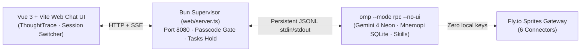
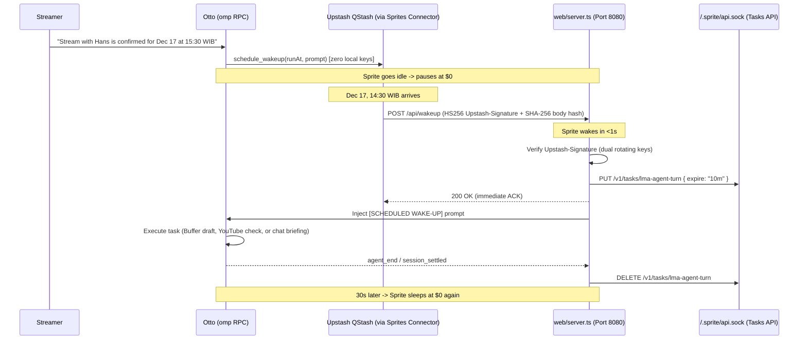
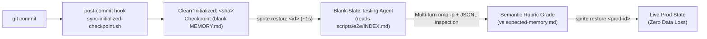
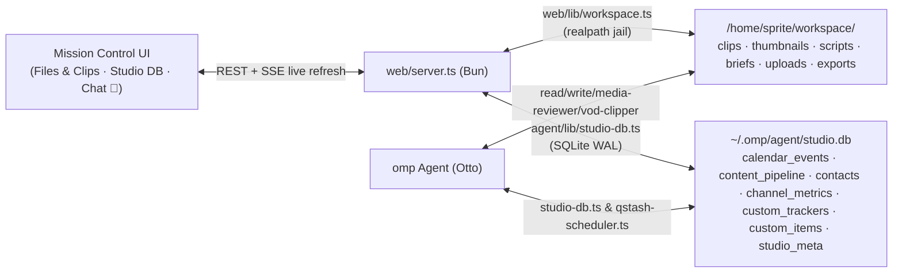

# Architecture Deep Dive — Why LMA (`lma`, Livestreamer Manager Agent) Uses `omp` RPC + Native Fly.io Sprites Primitives

This document explains the key engineering decisions behind **LMA (`lma` — Livestreamer Manager Agent)** — specifically why we chose **`omp` (`@oh-my-pi/pi-coding-agent`)** as the persistent agent engine, how we solved **proactive self-scheduling on a $0-idle sleeping Sprite**, and how we use **Sprites Connectors, Tasks API, and Checkpoints** together with zero outbound API keys inside the VM.

---

## 1. Why `omp --mode rpc --no-ui` Instead of a Custom Agent Loop

Most hackathon agents reinvent a brittle `while (toolCalls)` loop in Python or TypeScript, then spend 80% of their time fighting context compaction, tool-call retries, session persistence, and streaming bugs.

`lma` takes the opposite approach: treat **`omp`** as the real, battle-tested agent runtime inside the Sprite, and wrap it with a thin Bun supervisor (`web/server.ts`) speaking **`omp --mode rpc --no-ui`** over newline-delimited JSON (JSONL) stdin/stdout.

### What `omp` RPC gives us out of the box
| Capability | How `lma` Uses It |
| :--- | :--- |
| **Zero per-message cold start** | One persistent `omp` RPC worker stays warm inside `lma-web` (auto-restarts on exit) instead of spawning a new CLI process per turn. |
| **First-class streaming events** | `thinking_delta`, `text_delta`, `tool_execution_start`, and `tool_execution_end` stream straight to the Vue 3 `<ThoughtTrace>` component over SSE. |
| **Native session management** | `get_messages`, `new_session`, `switch_session`, and `abort` power multi-chat history and instant stop controls without a custom chat database. |
| **Dual-layer persistent memory** | Structured `MEMORY.md` studio profile (handles, timezone, team credits, OPSEC rules, schedule notes) paired with built-in **Mnemopi** SQLite memory (`noEmbeddings: true` for fast CPU-only FTS recall). |
| **Clean `ExtensionAPI` + Skills** | Connectors live as small, auto-discovering TypeScript extensions (`agent/extensions/*.ts`); ops workflows &amp; opt-in coaching live as Markdown skills (`agent/skills/`). |
| **Tool-level guardrails** | `generate_image: deny` and `generate_image.enabled: false` enforce the **strictly no AI-generated art/video** rule at the runtime layer, not just in prose. |

---

## 2. Proactive Self-Scheduling on a Sleeping Sprite (Upstash QStash + Tasks API)

Fly.io Sprites pause automatically after **~30 seconds of idle time** (warm suspend → cold stop), which keeps idle compute at **$0** — but also pauses any local Linux `cron` daemon inside the VM.

To let Otto be genuinely **proactive** (e.g., *"Remind me 1 hour before my collab stream on Dec 17 at 15:30 WIB, then pull the VOD afterward to cut raw clips"*), `lma` combines **Upstash QStash** with Fly.io's **`/.sprite/api.sock` Tasks API**:

### Why the `/.sprite/api.sock` Tasks API Hold Matters
Because `POST /api/wakeup` returns `200 OK` to QStash immediately and runs `omp` asynchronously, there is **no open browser SSE connection** during a headless wake-up. Without a keep-alive hold, a multi-tool agent turn taking >30 seconds could be paused mid-flight by the Sprite's idle detector.

Holding `PUT /v1/tasks/lma-agent-turn` (`expire: "10m"`) on `agent_start` (with a 5-minute refresh heartbeat while `rpc.busy` is active, capped at a hard 30-minute ceiling) and releasing `DELETE /v1/tasks/lma-agent-turn` on `agent_end`/`abort` keeps long multi-tool VOD clipping turns alive without letting a crash or hung turn leak billing indefinitely.

---

## 3. Zero Outbound API Keys (6 Auto-Discovering Sprites Connectors)

Every external API call routes through `https://api.sprites.dev/v1/gateway/...`:

- **Built-in BYOK Connectors:** Google Gemini, Exa, Firecrawl.
- **Custom API Connectors (provisioned via `sprite api /oauth/connections/custom_api`):**
  - **Composio v3 (`https://backend.composio.dev`, `x-api-key`)** — cleanly works around Sprites' built-in Composio v3.1 catalog validator mismatch while keeping 100% zero-key gateway security for YouTube channel stats, video metadata, captions, and human-approved packaging updates.
  - **Buffer (`https://api.buffer.com`, `Bearer`)** — single GraphQL API covering **X (Twitter), TikTok, and Instagram** (avoiding X's paid Pay-Per-Use API), defaulting to `saveToDraft: true` so nothing publishes publicly without human sign-off.
  - **Upstash QStash (`Bearer`)** — free 1,000 messages/day for agent self-scheduled wake-ups and recurring crons.

Every **connector** extension (`buffer-gateway`, `composio-youtube`, `exa-gateway`, `firecrawl-gateway`, `media-reviewer`, `qstash-scheduler`) queries `GET https://api.sprites.dev/v1/gateway/list` at runtime and caches its `gateway_base_url` — meaning **zero hardcoded connector IDs** exist anywhere in this repository. Local-only extensions (`studio-db`, `vod-clipper`, `skill-learner`, `new-session`) never touch the gateway.

---

## 4. Checkpoint Time-Travel &amp; Agentic E2E Testing

Stateful personal agents are notoriously painful to test end-to-end: persistent memory (`MEMORY.md`, Mnemopi SQLite) and conversation history bleed across runs, and LLM replies are non-deterministic so brittle exact-string unit tests break constantly.

**Fly.io Sprites' immutable copy-on-write checkpoints turned that bottleneck into our biggest development speed multiplier:**

1. **Perpetually Fresh Clean Baseline (`scripts/sync-initialized-checkpoint.sh` + `scripts/install-hooks.sh`):** Installed via `bash scripts/install-hooks.sh` into `.git/hooks/post-commit`, every code commit automatically snapshots live `MEMORY.md` (`prod: auto-backup`) if modified, syncs the repo to the Sprite, clears runtime sessions/memories/`mnemopi.db`/`studio.db`/`learned-skills`/`workspace/`, resets `MEMORY.md` to `MEMORY.md.example`, rebuilds `web/`, restarts `lma-web`, creates a fresh `initialized: <sha>` checkpoint, and prunes only previous `initialized:` checkpoints.
2. **Deterministic Fast Gate (`scripts/verify-all.sh`):** Runs 26 deterministic checks in ~10 seconds — TypeScript/Vite build, all 5 skill &amp; 10 extension symlinks, Python clipper compilation, `/.sprite/api.sock` Tasks API hold, `401` passcode &amp; QStash signature gates, path-traversal rejections, `CRON_TZ` validation, learned-playbook CRUD/gating, Unified Workspace PUT/GET/ZIP/DELETE round-trips, and Unified Studio DB SQLite CRUD checks.
3. **Agentic Multi-Turn E2E Playbooks (`scripts/e2e/`):** Instead of flaky regex assertions, behavioral tests live as Markdown playbooks (`01-onboarding.md` … `05-qstash-proactive-wakeup.md`) paired with a programmatic communication guide (`scripts/e2e/INDEX.md`) and a golden reference dossier (`scripts/e2e/expected-memory.md`). A completely blank-slate coding agent can restore `initialized:`, execute multi-turn conversations against Otto, inspect raw JSONL tool calls, semantically grade the resulting `MEMORY.md` against `expected-memory.md`, and jump straight back to live state in seconds — making iteration dramatically faster and consistently reproducible.

---

## 5. Unified 2-Way Studio Workspace &amp; Unified Studio Database (SQLite WAL)

Because `lma` runs on a single persistent NVMe Sprite powered by Bun, the Web UI (`web/server.ts`) and the `omp` agent share **both** a two-way filesystem workspace and a native SQLite WAL database with zero external database servers:

| Layer | Backing Store | Shared By | Live Sync Mechanism |
| :--- | :--- | :--- | :--- |
| **Unified Workspace** | `/home/sprite/workspace/` | Web File Manager + Chat `📎` uploads + `omp` (`read`/`write`/`vod-clipper`/`media-reviewer`) | `tool_execution_end` + debounced `fs.watch` -> SSE `workspace_changed` |
| **Unified Studio DB** | `~/.omp/agent/studio.db` (`bun:sqlite`, `WAL`, `busy_timeout=5000`) | Web `/api/db/*` &amp; `/api/calendar/*` + `omp` (`studio-db.ts` &amp; `qstash-scheduler.ts`) | `tool_execution_end` + API mutations -> SSE `db_changed` |
| **Talent Dossier** | `~/.omp/agent/MEMORY.md` | Mission Control Dossier view + `omp` system prompt memory | Reloaded on turn completion |
| **Chat Memory** | `~/.omp/agent/mnemopi.db` | Managed internally by `omp` | Automatic across sessions (cleared by the clean-checkpoint reset) |

### Learned Creator Playbooks (`agent/extensions/skill-learner.ts` + `agent/lib/learned-skills.ts`)

Recurring creator-specific SOPs live outside the repo so `git pull`/checkpoint syncs never clobber them:

- `learned_skills_list` / `learned_skill_read` / `learned_skill_save` / `learned_skill_delete` back a `learned-skills/<slug>/SKILL.md` store plus metadata in `studio.db`.
- New playbooks are staged `pending` and only become `active` after human review in Mission Control's `LearnedPlaybooksCard.vue` (`/api/learning*`).
- When enabled via `/api/learning/config` (or Mission Control), a **silent nightly-reflection wake-up** (QStash cron managed by `agent/lib/qstash-cron.ts`, timezone-aware via `CRON_TZ`) proposes candidates; untrusted external text (web pages, YouTube metadata, live chat) must never be promoted into instructions.

---

## 6. Defense-in-Depth Security

- **Zero outbound API keys in VM or repo:** All 6 external API credentials stay inside Fly.io's encrypted org gateway. Inbound verification secrets (`LMA_WEB_PASSWORD` and Upstash QStash signing keys) live in `chmod 600 ~/.config/lma/web.env` outside git, and `web/server.ts` strips them from the `omp` subprocess environment (`qstash-scheduler.ts` reads only non-secret routing env vars — `LMA_PUBLIC_URL` and the `SPRITES_*_GATEWAY_URL` overrides — and never opens `web.env`).
- **Fail-closed Web Chat UI gate:** `setup.sh` auto-generates `LMA_WEB_PASSWORD` in `~/.config/lma/web.env`; if unset, `web/server.ts` fails closed (`401` on `/` and every other `/api/*` route, `503` on `/api/auth/login`), rate-limits brute-force attempts (`429` keyed on `fly-client-ip` / rightmost proxy hop / socket IP), and sets `HttpOnly; SameSite=Lax` cookies (with `Secure` over HTTPS / `x-forwarded-proto: https`) verified with `crypto.timingSafeEqual`. Three routes sit deliberately before the gate: `GET /api/health` (public liveness probe) and `POST /api/auth/login` (the gate itself), plus `POST /api/wakeup`, which is not passcode-gated but requires a valid Upstash QStash signature.
- **Headless RPC execution model &amp; containment:** Because `omp` runs headlessly (`--mode rpc --no-ui`) inside a dedicated single-tenant Sprite VM, `agent/config.yml` uses `approvalMode: yolo` with hard tool-layer bans (`generate_image: deny`), strict `realpathSync` containment under `/home/sprite/workspace/` on `vod-clipper.ts` &amp; `media-reviewer.ts`, SSRF/size-capped thumbnail fetching, read-only SQL validation (`SELECT`/`WITH`/`PRAGMA table_info` only) on `studio_db_query`, and prompt-injection rules for untrusted web/chat data.
- **Workspace Root Jail &amp; Anti-Stored-XSS:** `web/lib/workspace.ts` enforces strict `path.resolve` + `fs.realpathSync` confinement inside `/home/sprite/workspace/`, blocks symlinks, dotfiles, and parent traversal (`..`), caps uploads at 100 MB and ZIP exports at 500 MB (skipping symlinks), and serves downloads/HTML/SVG/binaries with `Content-Disposition: attachment` + `X-Content-Type-Options: nosniff` so uploaded files can never execute scripts under the app origin.
- **Database Separation &amp; Parameterized Queries:** `~/.omp/agent/studio.db` lives outside `/home/sprite/workspace/` so file-manager operations cannot delete or corrupt the database, and every Web API / tool mutation uses parameterized SQLite statements.
- **Path-traversal protection:** `POST /api/sessions/switch`, `/api/workspace/*`, `/api/clips/file/...` (with HTTP `Range` 206 support), and static file serving strictly verify resolved paths remain within their authorized roots.
