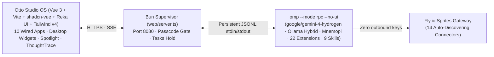
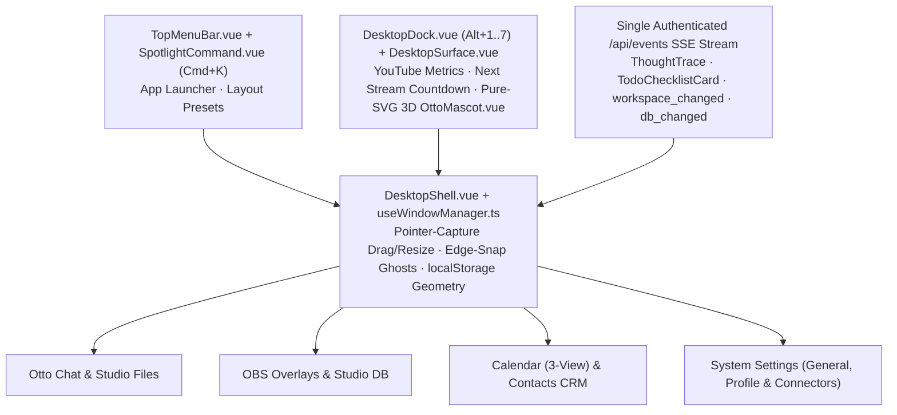
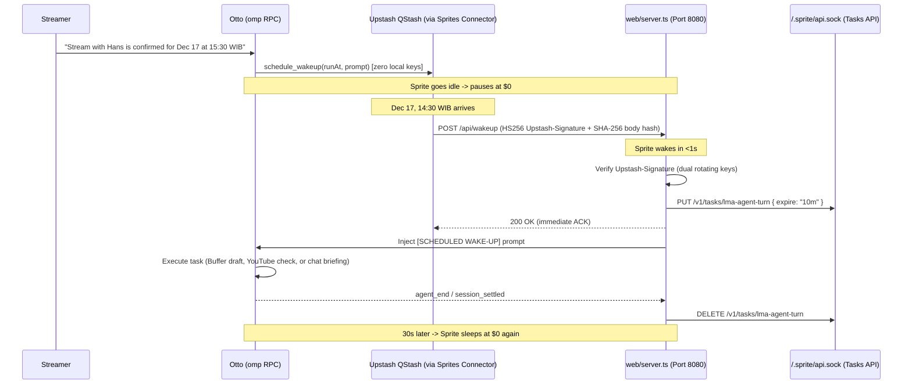
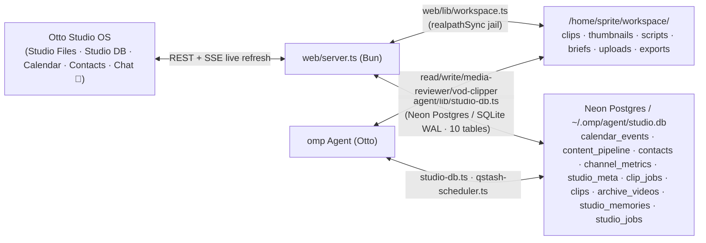
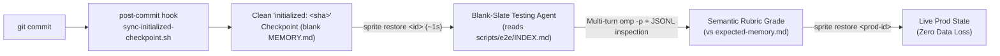

# Architecture Deep Dive — How Otto OS (`lma`) Combines `omp` RPC, Multi-Window Studio OS &amp; Native Fly.io Sprites Primitives

This document explains the core engineering decisions behind **Otto OS (`lma` — Livestreamer Manager Agent)** — specifically why we run **`omp` (`@oh-my-pi/pi-coding-agent`)** as a persistent RPC daemon, how **Otto Studio OS** coordinates 10 live-synced desktop apps and right-side Desktop Widgets over one SSE channel, how **proactive self-scheduling survives $0-idle auto-sleep**, and how every external API runs with **zero outbound API keys or session cookies inside the VM**.

---

## 1. Why `omp --mode rpc --no-ui` Instead of a Custom Agent Loop

Most hackathon agents reinvent a brittle `while (toolCalls)` loop in Python or TypeScript, then spend 80% of their time fighting context compaction, tool-call retries, session persistence, and streaming bugs.

Otto OS takes the opposite approach: treat **`omp`** as the battle-tested agent runtime inside the Sprite, and wrap it with a Bun supervisor (`web/server.ts`) speaking **`omp --mode rpc --no-ui`** over newline-delimited JSON (JSONL) stdin/stdout.

### What `omp` RPC Gives Us Out of the Box

| Capability | How Otto OS Uses It |
| :--- | :--- |
| **Zero per-message cold start** | One persistent `omp` RPC worker stays warm inside `lma-web` (auto-restarts on exit) instead of spawning a new CLI process per turn. |
| **Model role routing** | `agent/config.yml` defaults primary reasoning, vision, audio, and video roles to `google/gemini-4-hydrogen:auto` (with `high` for planning/vision) and lightweight roles (`smol`, `memory`, `autorename`) to `google/gemini-3.5-flash-lite`. |
| **First-class streaming events** | `thinking_delta`, `text_delta`, `tool_execution_start`, and `tool_execution_end` stream straight to the Vue 3 `<ThoughtTrace>` and `TodoChecklistCard` components over SSE. |
| **Native session management** | `get_messages`, `new_session`, `switch_session`, and `abort` power multi-chat history and instant stop controls without a custom chat database. |
| **Dual-layer persistent memory** | Structured `MEMORY.md` talent dossier (handles, timezone, team credits, OPSEC rules, schedule notes) paired with built-in **Mnemopi** SQLite memory (`noEmbeddings: true` for fast CPU-only FTS recall). |
| **Modular extensions &amp; skills** | **22 extensions** registering **85 tools** (+ `--new` CLI flag) in `agent/extensions/*.ts`, paired with **9 Markdown skills** (8 ops/craft + 1 opt-in `streaming-coaching` skill) in `agent/skills/`. |
| **Runtime-enforced guardrails** | `generate_image: deny` and `generate_image.enabled: false` enforce the **strictly no AI-generated art/video** rule at the tool-permission layer, not just in prose. |

---

## 2. Otto Studio OS Multi-Window Workstation

Instead of a single-column chat box with a cramped slide-over drawer, `web/` renders **Otto Studio OS** — a full multi-window cloud desktop built on **Vue 3 + Vite + `shadcn-vue` + Reka UI + Tailwind CSS v4**:

- **10 genuinely wired apps (`useWindowManager.ts` `StudioAppId`):** `otto-chat` (Otto Chat), `files` (2-way Studio Workspace + 1-click Box handoff), `obs-overlays` (Fly Machine-hosted overlay host: 16:9 iframe preview, copyable OBS Browser Source + mobile Remote Control Deck URLs, machine status &amp; delete), `thumbnails` (Zero-AI 1280×720 Thumbnail Studio with Box cutouts, Pixabay photography &amp; headless Chrome visual self-check), `clips` (3-page VOD → Clips → Clip Viewer with live ElevenLabs Scribe SRT overlay &amp; Creator Archive Pinecone semantic search), `ideas` (`IdeasWorkspaceApp.vue` for stream/video/short/collab ideas &amp; status tracking), `analytics` (`AnalyticsWorkspaceApp.vue` paired with the top-right `(Y)our channel.` widget: 0-LLM YouTube sync, daily QStash snapshots, sparkline, history table &amp; direct YouTube Studio deep links), `calendar` (Month/Week/Agenda views with live QStash wake-up badges `T-2h`/`T-15m` + `.ics` export), `contacts` (3-pane Creator Rolodex CRM for human artists, riggers, clippers, editors &amp; sponsors with 1-click zero-tool "Draft outreach with Otto"), and `settings` (`SystemSettingsApp.vue` with `General`, `Profile` dossier, `Connectors`, Hybrid LLM Router &amp; Time-Travel Checkpoints) — paired with live right-side **Desktop Widgets** (`ChannelMetricsWidget.vue`, `NextStreamWidget.vue`, and floating circular `OttoMascot.vue`).
- **Desktop ergonomics:** Pointer-capture drag and 8-edge resize, dashed yellow edge-snap ghosts (`left`, `right`, `maximize`), one-key layout presets (`tile-2up`, `focus-chat`, `cascade`, `show-desktop`, `reset`), macOS/Windows auto-adaptive traffic-light or caption controls, persistent `localStorage` window rects, and an automatic `<1024px` responsive single-app mode.
- **Spotlight (`SpotlightCommand.vue`):** `Cmd+K` / `Ctrl+K` searches apps, quick workspace folders, and layout presets.
- **Zero-cold-start onboarding &amp; zero-AI-art craft:** First run opens the 3-step `StudioSetupWizard.vue` (413 IANA timezones, atomic `0600` passcode rotation, live connector readiness) paired with headless `scripts/bootstrap-dossier.sh` (`omp --no-session` scanning YouTube, Buffer, 30-day Google Calendar, and Exa to pre-fill `MEMORY.md` before turn #1). `OttoMascot.vue` is a 100% pure-SVG 3D sphere using `requestAnimationFrame` damped yaw/pitch projection and dynamic specular keylight — zero AI-generated assets.

---

## 3. Proactive Self-Scheduling on a Sleeping Sprite (Upstash QStash + Tasks API)

Fly.io Sprites pause automatically after **~30 seconds of idle time** (warm suspend → cold stop), which keeps idle compute at **$0** — but also pauses any local Linux `cron` daemon inside the VM.

To let Otto be genuinely **proactive**, Otto OS combines **Upstash QStash** with Fly.io's **`/.sprite/api.sock` Tasks API**:

### Tasks API Keep-Alive Hold, Reschedule Delta Auto-Re-Arming &amp; RFC 5545 `.ics`

- **Keep-alive hold without leaked billing:** Because `POST /api/wakeup` ACKs QStash immediately and executes `omp` asynchronously without an open browser SSE stream, `web/server.ts` holds `PUT /v1/tasks/lma-agent-turn` (`expire: "10m"`) on `agent_start` (refreshed every 5 minutes while `rpc.busy` is active, capped at a hard 30-minute ceiling) and releases `DELETE /v1/tasks/lma-agent-turn` on `agent_end`/`abort`.
- **Reschedule delta auto-re-arming (`agent/extensions/qstash-scheduler.ts`):** When a stream moves via `calendar_update_event`, Otto computes the exact time delta between the old and new start timestamps, revokes existing QStash message IDs attached to that event, re-arms shifted lifecycle triggers (`promo_24h`, `pre_stream_1h`, `post_stream_vod_30m`), persists updated hook IDs in `studio.db`, and syncs the change 2-way with Google Calendar.
- **RFC 5545 `.ics` export with `VALARM` (`GET /api/calendar/export.ics`):** Generates standards-compliant iCalendar feeds from `calendar_events`, attaching `BEGIN:VALARM` / `TRIGGER:-PT15M` reminders so creators can subscribe from Apple Calendar, Google Calendar, or mobile devices.

---

## 4. Deterministic VOD Hype Pipeline &amp; Multimodal Media Reviewer

Rather than feeding 4-hour VOD transcripts into an expensive LLM and hoping it guesses where chat popped off, Otto OS splits clip discovery into **deterministic signal processing** followed by **bounded multimodal review**:

- **12-thread InnerTube parallel chat pull (`agent/skills/raw-clip-finder/scripts/fetch_chat_fast.py`):** Extracts YouTube's internal `playerSeekContinuationData` random-access token and fans out **12 concurrent threads** across 10-minute timeline chunks — pulling a **4-hour VOD's live chat replay in ~30 seconds** (versus 30–60 minutes of linear pagination) with zero API keys, alongside `yt-dlp` captions.
- **Chat-lag compensation &amp; 4-signal Z-score hype math (`detect_hype_candidates.py`):** Buckets chat into 10-second windows and scores 4 rolling Z-score signals (velocity `0.40`, unique-author burst `0.30`, reaction ratio `0.15`, emote burst `0.15`) with indie-channel adaptive `min_authors` thresholding and bilingual EN/ID hype + emote regexes. Because real stream ingest + CDN latency delays viewer chat reactions by 10–25 seconds, every candidate window applies a **35-second pre-roll** (+15s post-roll) so the setup and punchline are captured intact.
- **Broadcast-ready raw cut &amp; prep (`cut_raw_clip.py` + `vod_prep_clip`):** `cut_raw_clip.py` (`vod_cut_clip`) slices the exact raw `.mp4` + time-shifted `.srt`, and `vod_prep_clip` (`agent/extensions/vod-clipper.ts`) normalizes it via `ffmpeg` to CFR 30fps H.264 `yuv420p` `+faststart` at **-14 LUFS**, saved directly into `/home/sprite/workspace/clips/` for inline HTTP 206 playback and human editor handoff.
- **Dynamic 480p/2fps FFmpeg proxy + hardened SSRF guard (`agent/extensions/media-reviewer.ts`):**
  - `watch_clip` inspects file size; clips exceeding **14 MB** are automatically transcoded on the fly via `ffmpeg` (`scale=-2:480 -r 2`) into a lightweight proxy for inline Gemini multimodal critique with **zero external object storage**.
  - `critique_thumbnail` enforces HTTPS-only SSRF protection — rejecting `localhost`, `::1`, `.local`, `.internal`, `169.254.*`, `10.*`, `192.168.*`, and `172.16-31.*`, performing manual redirect validation (max 4 hops), and capping response streams at 14 MB.

---

## 5. Zero Outbound API Keys (14 Auto-Discovering Sprites Connectors)

Every key-bearing external API routes through `https://api.sprites.dev/v1/gateway/...`:

- **Built-in Connectors:** Google Gemini (`models.yml`), **Ollama Cloud** (Hybrid LLM Router primary for smol/memory/widget roles with Gemini circuit-breaker failover in `web/lib/llm-router.ts`), **Neon Postgres** (`agent/lib/neon-db.ts`), **Pinecone** (`agent/lib/pinecone-archive.ts`, `agent/lib/cloud-memory.ts`), **Box** (OAuth human-team clip &amp; brief handoff via `box-gateway.ts` &amp; `agent/lib/box.ts`), **ElevenLabs** (`agent/lib/elevenlabs-stt.ts`), **Apify** (`agent/lib/apify.ts`), Exa (`exa-gateway.ts`), Firecrawl (`firecrawl-gateway.ts`).
- **Custom API Connectors (provisioned via `sprite api /oauth/connections/custom_api`):**
  - **Composio v3 (`https://backend.composio.dev`, `x-api-key`)** — handles YouTube channel stats, video metadata, captions, human-approved packaging updates, and 2-way Google Calendar sync (`composio-youtube.ts`).
  - **Pixabay (`https://pixabay.com/api`, query key)** — royalty-free, strictly non-AI human photography for Thumbnail Studio (`agent/lib/pixabay.ts`).
  - **Buffer (`https://api.buffer.com`, `Bearer`)** — single GraphQL API covering **X (Twitter), TikTok, and Instagram**, defaulting to `saveToDraft: true` so nothing publishes publicly without human sign-off (`agent/lib/buffer.ts` + `social-channels.ts` / `x-twitter.ts` / `tiktok.ts` / `instagram.ts`).
  - **Upstash QStash (`Bearer`)** — agent self-scheduled one-shot, lifecycle, and `CRON_TZ` recurring wake-ups (`qstash-scheduler.ts`).
  - **Fly Machines (`https://api.machines.dev`)** — zero-Docker provisioning of a dedicated `256 MB` auto-stop Machine + `1 GB` Volume for public, transparent OBS Browser Sources and SSE Remote Control Decks (`agent/lib/obs-overlays.ts`, `obs-overlays.ts`).

Across the **22 extensions** (**85 registered tools** + `--new`), all **14 zero-key Sprites Connectors** (used by `box-gateway`, `social-channels`, `x-twitter`, `tiktok`, `instagram`, `composio-youtube`, `google-calendar`, `exa-gateway`, `firecrawl-gateway`, `media-reviewer`, `qstash-scheduler`, `obs-overlays`, `pixabay`, etc.) query `GET https://api.sprites.dev/v1/gateway/list` at runtime and cache their authorized `gateway_base_url` — leaving **zero hardcoded connector IDs** in the repo. Local-only extensions (`studio-apps`, `studio-db`, `vod-clipper`, `new-session`, etc.) never require outbound connector credentials.

---

## 6. Unified 2-Way Studio Workspace &amp; 10-Table Neon Postgres / SQLite WAL DB

Because Otto OS runs on a single persistent NVMe Sprite powered by Bun, the Web UI (`web/server.ts`) and the `omp` agent share **both** a two-way filesystem workspace and a **10-table Neon Serverless Postgres database (with local SQLite WAL fallback)**:

| Layer | Backing Store | Shared By | Live Sync Mechanism |
| :--- | :--- | :--- | :--- |
| **Unified Workspace** | `/home/sprite/workspace/` | Studio Files app + Chat `📎` uploads + `omp` (`read`/`write`/`vod-clipper`/`media-reviewer`) | `tool_execution_end` + debounced `fs.watch` → SSE `workspace_changed` |
| **Unified Studio DB** | Neon Serverless Postgres / `~/.omp/agent/studio.db` (`WAL`, `busy_timeout=5000`, 10 tables) | Web `/api/db/*`, `/api/calendar/*` + `omp` (DB tools + QStash) | `tool_execution_end` + API mutations → SSE `db_changed` |
| **Talent Dossier** | `~/.omp/agent/MEMORY.md` | Mission Control Dossier view + `omp` system prompt memory | Reloaded on turn completion |
| **Chat Memory** | `~/.omp/agent/mnemopi.db` | Managed internally by `omp` | Automatic across sessions (cleared by clean-checkpoint reset) |

---

## 7. Checkpoint Time-Travel &amp; Reproducible Verification

Stateful personal agents are notoriously painful to test end-to-end: persistent memory (`MEMORY.md`, Mnemopi SQLite) and conversation history bleed across runs, and LLM replies are non-deterministic. **Fly.io Sprites' immutable copy-on-write checkpoints** turn that bottleneck into a 1-second reset loop:

1. **Perpetually Fresh Clean Baseline (`scripts/sync-initialized-checkpoint.sh` + `scripts/install-hooks.sh`):** On every code commit, `.git/hooks/post-commit` backs up live `MEMORY.md` (`prod: auto-backup`) if modified, syncs the repo to the Sprite, clears runtime sessions/memories/`mnemopi.db`/`studio.db`/`studio-apps`/`workspace/`, seeds `MEMORY.md` from the gitignored live dossier by default (`--no-memory` restores the blank `MEMORY.md.example`), rebuilds `web/`, restarts `lma-web`, creates a fresh `initialized: <sha>` checkpoint, and prunes only older `initialized:` checkpoints.
2. **Offline Automated Test Suite &amp; CI (`tests/` + `.github/workflows/ci.yml`):** Zero-network Node 22 + Python `unittest` regression suite (`npm test` + `python3 -m unittest discover -s tests`) verifying fail-closed scrypt auth, LRU session protection, QStash HS256 JWT (`alg` + `sub` + SHA-256 body), `CRON_TZ` validation, realpath workspace jail, `child-env` secret stripping, RPC busy-lock TOCTOU &amp; long-turn timeout handling, Ollama→Gemini circuit-breaker failover, 10-table SQLite CRUD &amp; read-only SQL allowlist, zero-key connector adapters (Apify/Box/Fly Machines/Buffer/Gateway), checkpoint ID parsing, sandbox escaping, and Python hype-detector math — executable locally on any laptop without a Sprite.
3. **Deterministic Live-Sprite Gate (`scripts/verify-all.sh`):** Runs **28 deterministic fast checks** in ~10 seconds (plus live probes with `--live`) — TypeScript/Vite build, all **9 skill** &amp; **22 extension** symlinks, Python clipper compilation, `/.sprite/api.sock` Tasks API hold, `401` passcode &amp; QStash signature gates, path-traversal rejections, `CRON_TZ` validation, Unified Workspace PUT/GET/ZIP/DELETE round-trips, and Unified Studio DB CRUD checks.
4. **Agentic Multi-Turn E2E Playbooks (`scripts/e2e/`):** Behavioral tests live as **5 Markdown playbooks** (`01-onboarding.md` … `05-qstash-proactive-wakeup.md`) paired with [`scripts/e2e/INDEX.md`](../scripts/e2e/INDEX.md) and a golden reference dossier ([`scripts/e2e/expected-memory.md`](../scripts/e2e/expected-memory.md)).

---

## 8. Defense-in-Depth Security

- **Zero outbound API keys or session cookies + live runtime audit:** All 14 external API connectors stay inside Fly.io's encrypted org gateway. `GET /api/connectors` dynamically inspects `process.env` (`zeroOutboundApiKeys` / `zeroLocalKeys`, `inboundSigningKeysConfigured`, `inboundKeysIsolatedFromAgent`) and `agent/config.yml` (`aiMediaDisabled: true`) on every load. Inbound verification secrets (`LMA_WEB_PASSWORD_HASH` and Upstash QStash signing keys) live in `chmod 600 ~/.config/lma/web.env` outside git and are stripped from the `omp` subprocess environment (`qstash-scheduler.ts` reads only non-secret routing vars and never opens `web.env`).
- **Zero-tool prompt-injection boundary on isolated drafting (`web/routes/isolated-ai.ts`):** `/api/contacts/draft-outreach` loads only `~/.omp/agent/MEMORY.md` server-side, wraps untrusted contact fields in `<untrusted_contact_data>` delimiters, and executes `omp --no-tools` (zero filesystem or shell access). Unauthenticated `GET /api/health` returns only `{ ok: true, status: "healthy" }`.
- **Ephemeral internal IPC auth:** Loopback `/api/internal/*` endpoints (used by `studio-apps` and `obs-overlays` to open windows in the desktop UI) require the per-boot 24-byte `LMA_INTERNAL_SECRET` bearer token; external callers cannot invoke them.
- **Fail-closed Web UI gate &amp; QStash signature verification:** `setup.sh` auto-generates `LMA_WEB_PASSWORD`; if unset, `web/server.ts` fails closed (`401` on `/` and `/api/*`, `503` on `/api/auth/login`), rate-limits brute-force attempts (5/min `429` keyed on `fly-client-ip` / rightmost proxy hop / socket IP), and issues `HttpOnly; SameSite=Lax` cookies (`Secure` over HTTPS) verified via `crypto.timingSafeEqual`. `POST /api/wakeup` validates dual rotating QStash HS256 JWT keys plus a constant-time SHA-256 raw-body digest.
- **Headless RPC containment &amp; tool guardrails:** Because `omp` runs headlessly inside a single-tenant Sprite VM, `agent/config.yml` pairs `approvalMode: yolo` (autonomy for research, clipping, and scheduling) with hard tool-layer bans (`generate_image: deny`), strict `realpathSync` confinement under `/home/sprite/workspace/` on `vod-clipper.ts` &amp; `media-reviewer.ts`, HTTPS-only SSRF guards on `critique_thumbnail`, read-only SQL allowlist (`SELECT`/`WITH`/`PRAGMA table_info` only, single statement, mutation-keyword denylist, 100-row cap) on `studio_db_query`, and prompt-injection rules for untrusted web/chat data.
- **Workspace root jail &amp; anti-stored-XSS (`web/lib/workspace.ts`):** Enforces `path.resolve` + `fs.realpathSync` confinement inside `/home/sprite/workspace/`, rejects symlinks, dotfiles, and `..` traversal, caps uploads at 100 MB and pre-flight ZIP exports at 500 MB (`followlinks=False`), and serves downloads/HTML/SVG/binaries with `Content-Disposition: attachment` + `X-Content-Type-Options: nosniff`.
- **Database separation &amp; parameterized queries:** `~/.omp/agent/studio.db` lives outside `/home/sprite/workspace/` so file-manager operations cannot delete or corrupt it, and every API and tool mutation uses parameterized SQLite queries.

---

## Security, Gateway & Sync Technical Notes

- **Sprites Platform Caller-Binding (Zero-Key Connectors):** Calls to `https://api.sprites.dev/v1/gateway/...` intentionally omit an `Authorization` header because the Fly.io Sprites platform authenticates the caller at the VM/network boundary and injects the organization-level connector credential upstream.
- **`omp` Exact-Case Env-Var Resolution (`models.yml`):** `omp` resolves `apiKey: LMA_INTERNAL_SECRET` by bare exact-case environment variable name (rather than `${VAR}` interpolation), keeping the ephemeral internal secret out of `models.yml` on disk.
- **Salted `scrypt` PIN Storage & `child-env` Isolation:** `~/.config/lma/web.env` (`chmod 600`) stores `LMA_WEB_PASSWORD_HASH=scrypt$<salt>$<key>` (never plaintext PINs) alongside random 256-bit server-side session tokens (`HttpOnly`, `SameSite=Lax`, `Secure` over HTTPS). `web/lib/child-env.ts` applies an explicit allowlist when spawning `omp` so auth, webhook, and DB secrets are stripped from the agent environment. *(Single-UID Sprite threat boundary: `omp` runs as the same `sprite` UID in `yolo` mode, so hashed PINs and random session IDs prevent direct credential theft; multi-user deployments should isolate the agent under a separate OS user.)*
- **Pull-Only Boot Box Sync:** At `web/server.ts` boot, `syncWorkspaceWithBox({ push: false })` only pulls from `Otto Assets/`; pushes to `Otto Handoffs/` happen only on explicit creator or agent action.
- **Deterministic Hype Defaults & Verification:** `detect_hype_candidates.py` uses a **60-second pre-roll / 45-second post-roll** window, and `scripts/verify-all.sh` runs **28 deterministic checks** (`+ live probes` with `--live`).
